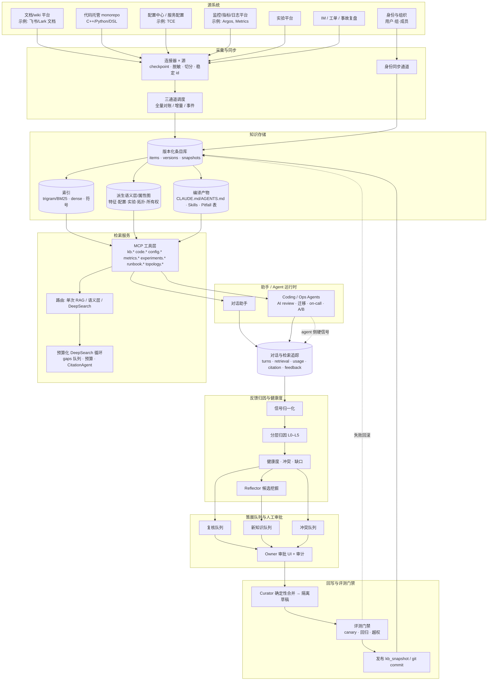
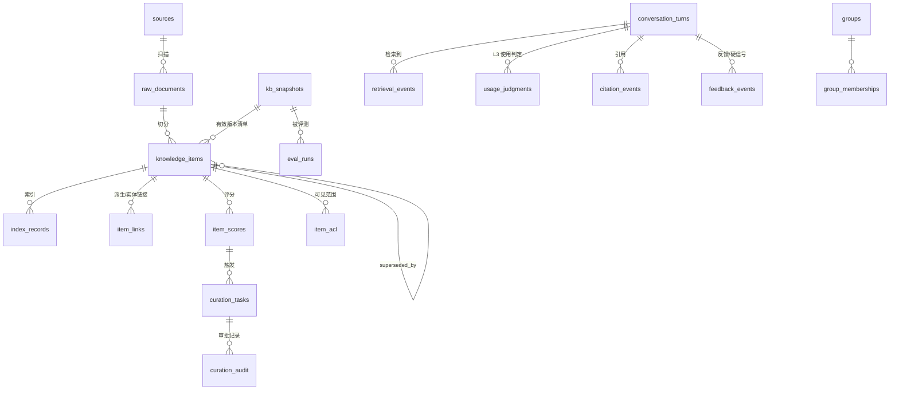
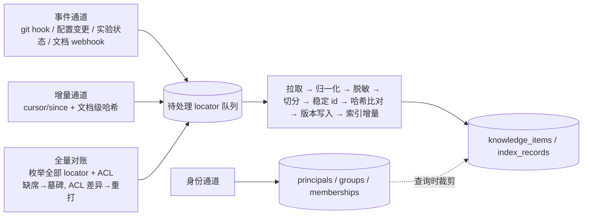
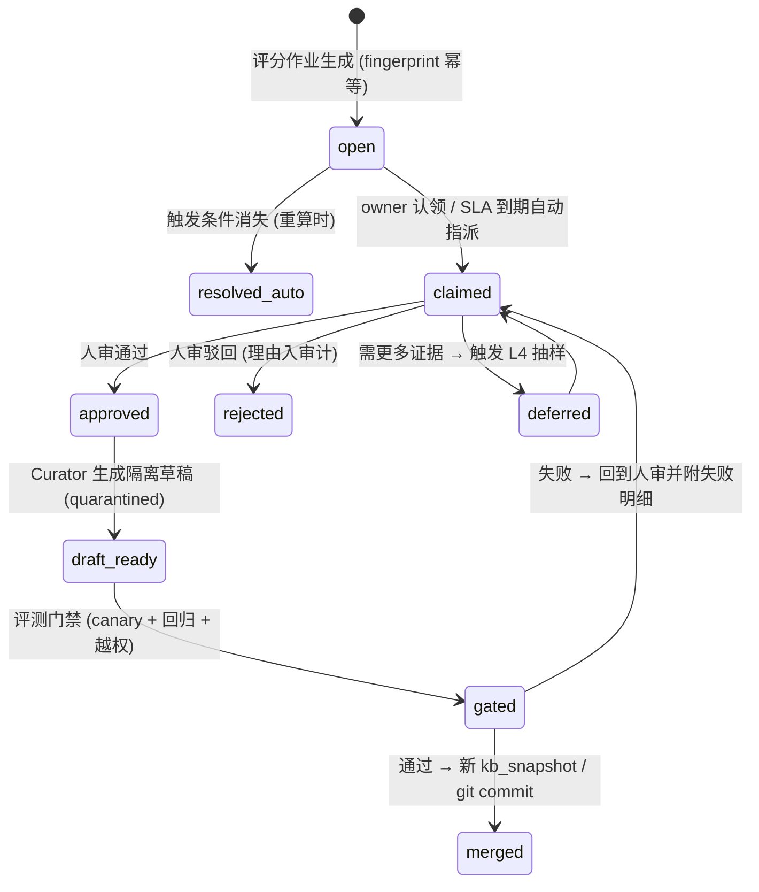

# 研发知识库与对话反馈闭环：设计方案

> **文档定位**：把《内部知识库构建更新与对话反馈评测》报告（下称"报告"）的"设计结论"落成可开工的工程设计；配套文档为《研发知识库与对话反馈闭环_评测方案》（下称"评测方案"）。读者是推荐架构负责人与承建的平台团队。参考实现是 `research/agent/prototypes/knowledge-loop/`（下称"原型"，纯标准库，`run_demo.py` 可完整跑通闭环），每个组件处说明原型已验证什么、离生产还差什么。
>
> **取证约定**：沿用报告标注——**厂商自报**、**据报道**（二手转述）、**据摘要**（仅见于摘要）、**推断**（本文基于证据的推断）；未标注者为可直接打开的官方文档、论文或代码库原文。本文所有阈值、权重、SLO 数值除非另有说明均为**初始默认值（推断）**，需按评测方案在内部数据上校准。
>
> **平台命名**：内部平台一律以通用名称指代（代码托管、配置中心、监控/指标平台、实验平台、文档/IM 平台、工单/事故平台）；个别处出现的 TCE / Argos / Metrics / 飞书(Lark) 均为**示例**，设计与具体平台无关。日期：2026-10-16。

---

## 0. 摘要与"与报告设计结论的关系"

**一句话架构**：源系统 → 三通道同步（全量对账 / 增量 / 事件加速）→ 版本化条目库（稳定 `item_id` + `version`，`valid_from/valid_to/superseded_by`，溯源与 ACL）→ 词法优先的混合索引 + 从系统导出的语义层 → 以 MCP 工具暴露的检索服务（单次 RAG 默认，预算化 DeepSearch 按需）→ 助手/Agent 运行时（每个结论绑定 `item_id@version`）→ 全量对话与检索追踪 → 分层归因与健康度 → 三条带 owner 的策展队列 → **人工审批后**回写 → 评测门禁（版本对 canary + 回归）后发布新 KB 快照。

源优先级、三通道同步、统一条目 schema、hybrid 检索 + MCP 工具 + 路由、"失效不删除"、分层归因、健康度做成队列、无静默写回、五层评测、K0–K3 分期——全部沿用报告设计结论。下表是本文**有意偏离或细化**之处：

| # | 报告设计结论要点 | 本文处理 | 理由 |
|---|---|---|---|
| D1 | "知识库本身放 git，每次人审合并是一个附带评测结果的 commit" | **分两层**：机器派生条目（代码/配置/日志模板/实验记录，百万量级）存版本化条目库（DB），以 `kb_snapshot_id` 做可回滚快照；**人工策展层**（lesson / pitfall / Skill / CLAUDE.md / 语义层定义 / 别名表）放 git，每次人审合并为带评测结果的 commit | 百万级、分钟级变化的派生条目逐版本进 git 不可用；git 的价值在"人改的东西可 diff/回滚/review"，派生条目由快照 id 承担同样功能（§3.3） |
| D2 | "文档侧只保留当前有效版本 + supersedes 指针，历史版本留在源系统" | 保留**被日志引用过**的历史版本正文（任何 `retrieval_events`/`citation_events` 出现过的 `id@version`）至保留期结束；从未被引用的旧版本只留元数据与 locator | 归因、反事实消融与评测回放需要当时正文（§6.3）；未被引用的版本无此需求 |
| D3 | 工具集 `lexical_search / semantic_search / kb_sql / read_doc / fetch_runbook` | 合并为 **`kb.search(mode=lexical\|semantic\|hybrid)`**，并增加按模态的精确工具（`code.grep / code.symbol / config.get / metrics.query / experiments.lookup / runbook.find / topology.neighbors`） | "工具少而正交"：`mode` 让 agent 仍做出可记录的选择；标识符类查询由专用精确工具承接（§5.3） |
| D4 | 归因编号 L0 曝光/位置、L1 引用、L2 LLM 使用判定、L3 反事实、L4 Shapley、L5 白盒显著性 | 采用任务书编号：**L0 曝光、L1 位置加权、L2 引用、L3 LLM 使用判定、L4 抽样 leave-one-out、L5 争议条目 Shapley**；白盒显著性为 L4 的可选实现 | 仅编号差异，语义一致；与评测方案统一 |
| D5 | 健康度 = Beta 后验 + hard-failure + staleness + 冲突 + 曝光（未给权重） | 给出可执行公式与初始权重；**hard-failure 做成硬上限**而非加权项；加时间衰减与来源系数（§6.4） | 原型验证了加权和可用；生产需要"一条硬失败即压低"语义，加权会被曝光稀释 |
| D6 | 对话派生知识"检索时对 ai_auto 降权或默认排除" | 再加**检索结果份额上限**（初始 20%）与**隔离期**（未验证不进默认检索） | 防 RAG Collapse 类自我强化的双保险（§6.7） |

> 依据：报告"设计结论"；原型 README §3、§7、§9。

---

## 1. 目标、非目标、设计原则

### 1.1 场景与约束

| 约束（来自需求） | 对设计的影响 |
|---|---|
| 全部门用于**系统迭代**（设计、改配置、排障、做实验），回答会被执行 | 错误知识直接变成错误操作 → agent 侧硬信号是一等信号（§6.2） |
| 平台方看到每一轮对话，并精确知道每轮检索到/使用了哪些条目 | 追踪必须记 `item_id@version + rank + score + 使用判定`（§6.1）；检索评测可按 ID 确定性计算 |
| 原始知识 = 文档/wiki、源码、平台/服务配置、运行日志与指标、实验记录 | 六类模态，变化频率差两个数量级 → 分模态连接器与分档 SLO（§4） |
| 原始知识持续变化，KB 必须跟随 | 增量通道不传删除与权限 → 周期性全量对账不可省（§4.2） |
| 对话数据用于评估、调整、退役、新增知识 | 闭环，但调研未发现任何公开组织做成全自动 → 无静默写回，人审是回路的一部分（§6.7） |

### 1.2 目标与非目标

| 编号 | 目标 | 验收（详见评测方案） |
|---|---|---|
| G1 可追溯 | 任何结论都能回溯 `item_id@version → source_locator` | 引用越界率 = 0；每条引用可打开源 |
| G2 跟得上变化 | 源变更→可检索 p95 按源分档达标；删除/权限在一个对账周期内生效 | §4.5 SLO；canary staleness rate |
| G3 精确优先 | 标识符查询（PSM、特征名、配置键、实验 ID）召回不低于词法基线 | 精确标识符 Recall@10 独立监控 |
| G4 从使用中学习 | 每周产出带证据的策展任务与候选知识并被 owner 处理 | 队列 SLA 达成率；候选接受率；证据→发布中位时长 |
| G5 可证明有效 | 每次 KB 变更有回归门禁；闭环上线前后有预注册对照 | CI 门禁通过率；评测方案 §7 |
| G6 安全 | 答案遵循提问者权限；PII/密钥不进索引；对话派生知识不自我强化 | 越权测试 = 0；DLP = 0；来源构成审计 |

非目标：不做 LLM 抽取式 GraphRAG（图只从系统导出）；不用 1M 上下文替代索引；不做全自动"对话→知识"写回；不以助手回答原文为知识；KB 不替代源系统（wiki/代码仓/配置中心仍是各自真相，KB 是派生、可重建的层，人工策展层除外）；K0–K2 不训练检索 agent；不设计个人记忆产品（只规定其与组织 KB 物理隔离）。

### 1.3 设计原则

| 原则 | 含义 | 硬规则 | 依据 |
|---|---|---|---|
| P1 版本化与可追溯 | 稳定逻辑 id + 单调版本；日志记物理键 `id@version` | 禁止原地修改已发布版本正文（§4.3）；评测结果以 `kb_snapshot_id` 为主键 | 报告 §二；原型 `models.item_key` |
| P2 平台裁决、人类审批 | 系统只做降权/置待验证/打标/生成草稿；发布、覆盖、删除必须人审 | 任务状态机没有"自动 merged"的边（§6.5） | 报告 §四；AgentX 报告 §6.3 |
| P3 无静默回写 | 进入检索的新知识都有 provenance 与审批记录 | 助手回答原文永不入库；`ai_auto` 默认不检索 | 报告 §四（RAG Collapse 79.6%，据摘要） |
| P4 检索优先精确匹配 | 词法/trigram 第一公民，dense 第二工具 | `kb.search` 默认 hybrid 且 RRF 以词法为主；标识符查询走精确工具 | 报告 §三（"Is Grep All You Need"、CodeRAG-Bench） |
| P5 评测先行 | 先有 20–50 条真实失败 golden set 再改检索/模型/KB | 任何快照、索引、模型、prompt 变更都过门禁 | Anthropic evals 指南；报告 §五 |
| P6 全量对账是删除与权限唯一真相 | 增量与事件只是加速器 | 每个落库源必须配对账周期；缺席即告警 | 报告 §二（五家平台一致） |
| P7 源优先级明确 | 系统事实 > 历史记录 > wiki/设计文档 > 日志 | 冲突按来源类别与版本裁决；日志只存模板 | 报告 §一 |
| P8 结构化在前，LLM 在后 | 能用 schema/解析器/lint 的不用 LLM | 冲突检测先跑确定性核对（文档值 vs 配置值）再跑 NLI | 报告 §一；原型 `detect_value_conflicts` |
| P9 权限随提问者 | 检索与回答按提问者当前权限裁剪 | 组成员独立同步；高敏感源直连不落库 | 报告 §二；飞书权限说明 |
| P10 评审者注意力是瓶颈 | 最大化"每分钟人工评审获得的证据量" | 队列按曝光×风险排序；Curator 确定性去重后人只看增量 | 报告"结论" |

---

## 2. 总体架构



各层职责、关键组件与原型模块的对应见 §10。两条回路与一个隔离带：**变更回路**（秒到天）源变更→连接器→新版本→索引增量→新快照，全自动但只派生不创造知识；**反馈回路**（周级）对话→归因→队列→人审→Curator 草稿→门禁→发布，创造或修改知识的每一步都有人类审批或评测门禁；**隔离带**：对话派生条目（`source_class ∈ {ai_draft_human_approved, conversation_derived}`）逻辑隔离（独立 `source_id='curation'`、份额上限、独立审计），个人记忆不在本系统内。

---

## 3. 数据模型



### 3.1 表与关键列

约定：时间戳 ISO-8601 UTC；JSON 列 `jsonb`。"原型"列：✓ 已有 / 部分 / ✗。

| 表 | 关键列 | 原型 | 生产新增 |
|---|---|---|---|
| **sources** | `source_id` PK（如 `code:monorepo`, `cfg:center:prod`）；`source_class ∈ {system_fact, history, doc, log, conversation}`（P7 优先级）；`connector_type`, `root_locator`, `tenant_id`；`sync_policy{full_reconcile_cron, incremental_interval_s, event_topics[], federated}`；`acl_mode ∈ {inherit_source, static_groups, federated_at_query}`；`pii_policy`；三通道水位 `last_full_reconcile_at / last_incremental_at / last_event_at`；`sync_count` | 部分 | `source_class`、`sync_policy`、`acl_mode`、`pii_policy`、水位 |
| **raw_documents**（原型 `source_files`） | `(source_id, locator)` PK；`content_sha256`, `source_mtime`, `source_version`（commit/revision）；`first_seen_at`, `last_changed_at`, `fetched_at`, `deleted_at`（仅全量对账写）；`acl_snapshot_hash`；`pii_scan_status ∈ {clean, redacted, blocked}` | ✓ | `source_version`、`acl_snapshot_hash`、`pii_scan_status` |
| **knowledge_items** | `item_id` = `sha1(source_id\|locator\|kind\|anchor)[:16]`（anchor 按模态：标题路径/限定符号名/key-path/模板 id/实验 id）；`version`，`(item_id, version)` PK；`kind ∈ {doc, code, config, log_template, metric_def, experiment, incident, ticket, lesson, pitfall, runbook}`；`locator` JSON（§3.2）；`title`, `text`, `context_header`（`来源 \| 路径 \| 章节/符号 \| 版本 \| 环境`，进入索引与证据）；`content_hash`；`valid_from`, `valid_to`, `superseded_by`, `status ∈ {active, superseded, deleted, quarantined, archived}`；`provenance{source_class, derived_from[], evidence_turn_ids[], extractor_version, approved_by, approval_task_id}`；`item_acl` 外键；`sensitivity ∈ {public_internal, restricted, confidential}`；`pii_tags{redacted[], blocked}`；`owner_team`, `owner_user`, `backup_owner`；`last_verified_at`, `verified_by`, `verify_ttl_days`；`env`；`metadata` JSON（模态专属：`kv`、符号签名、模板计数、指标快照）；`tenant_id`, `retention_class` | ✓（id 12 位，kind 5 种，无 quarantined/archived） | `provenance`、`sensitivity`、`pii_tags`、owner、`verify_ttl`、`env`、租户/保留期 |
| **kb_snapshots** | `kb_snapshot_id` PK；`created_at`, `trigger ∈ {sync, curation_merge, rollback}`；`item_version_manifest_ref`（有效 `(item_id, version)` 清单）；`index_build_id`, `embedding_model_id`, `curation_git_sha`；`eval_run_id`, `gate_status` | ✗（`sync_count` 近似） | 全部 |
| **index_records** | `(index_name, item_id, version)` PK，`index_name ∈ {lexical_main, dense_<model>_<ns>, symbol, template}`；`namespace`；`doc_key`, `embedding_model_id`, `built_at`, `status` | ✗（内存索引） | 持久化账本 |
| **item_links** | `src_item_id`, `dst_item_id`, `relation ∈ {mentions_feature, configures_service, runbook_for_template, experiment_changed_config, upstream_of, owned_by}`；`derived_by ∈ {system, linker}`, `confidence`, `source_version` | 部分（日志模板→runbook `related_docs`） | 系统导出关系、实体链接 |
| **principals / groups / group_memberships / item_acl** | `item_acl(item_id, version, principal_type, principal_id, effect ∈ {allow, deny})`，`deny` 优先；组成员**不展开**进条目 | 部分（组级字符串） | 独立 ACL 主语表 |
| **conversation_turns** | `turn_id` PK, `session_id`, `user_id`（哈希）, `user_groups_hash`；`channel`, `surface`；`query`, `answer`, `answer_hash`, `abstained`；`route ∈ {single_shot, semantic_layer, deep_search}`, `budget_used{steps, tool_calls, tokens, stop_reason, coverage}`；**`model_version`, `prompt_version`, `kb_snapshot_id`, `judge_version`**（所有对比的主键）；`task_ref`（工单/PR/实验/事故 id）；`guardrail_flags[]`；`trace` JSON | ✓（无主键四元组、`task_ref`、`route`） | 四个版本主键、`task_ref`、`channel` |
| **retrieval_events** | `turn_id`, `step`, `tool`, `query_text`；`item_id`, `version`, `rank`, `score`, `signals{bm25, dense, rrf, rerank, exact, filters}`；`exposed_to_model`（区分"检索到"与"喂给模型"） | ✓ | `tool`、`exposed_to_model` |
| **usage_judgments**（L3） | `turn_id`, `item_id`, `version`, `used`, `confidence`, `claims[{claim, span}]`；`judge_version`, `judged_at` | ✗ | 全部 |
| **citation_events** | `turn_id`, `item_id`, `version`, `position`, `claim_span`, `supported`（引用支持 judge 回填） | ✓ | `claim_span`、`supported` |
| **feedback_events** | `event_id`, `turn_id`；`kind ∈ {explicit_thumbs, explicit_rating, correction_text, regenerate, reformulated, clarify_asked, abandoned, copied, opened_source, applied_action, task_success, task_failure, repeat_question, escalated, agent_tool_error, agent_schema_reject, agent_path_missing, agent_test_failed, guardrail_triggered}`；`signal_class ∈ {explicit, implicit_conv, task_outcome, agent_hard}`；`value`, `text`（脱敏）, `evidence_ref`（工具输出/测试报告/工单）；`attributed_item`（硬信号可直接指向 `id@version` 与步骤）；`created_at`, `delay_s` | ✓（5 种） | 硬信号与结果信号种类、`attributed_item`、`evidence_ref` |
| **item_scores** | `(item_id, version, window ∈ {7d, 30d, 90d, all})` PK；`exposures`, `exposed_users`, `used_count`, `cited_count`（衰减后）；`helpful_alpha`, `harmful_beta`, `helpful_mean`, `helpful_lb`；`hard_failures`, `last_hard_failure_at`；`staleness_flags[]`, `conflict_flags[]`；`health`, `components`, `reasons`, `computed_at` | ✓（无 used、Beta、硬失败、窗口） | Beta 后验、硬失败、窗口 |
| **curation_tasks** | `task_id`, `task_type ∈ {verify, update, deprecate, merge, fill_gap, promote_candidate, resolve_conflict, acl_review}`；`item_ids[]`, `priority`, `reason`, `evidence`（turn ids、硬信号、diff、冲突对）；`owner_team`, `assignee`, `sla_due_at`；`status`（§6.5 状态机）；`fingerprint` UNIQUE；`draft_ref`（Curator 草稿 `id@version`，status=quarantined） | ✓（6 类；open/resolved/done；fingerprint） | owner/SLA、状态机、草稿引用 |
| **curation_audit** | `task_id`, `actor`, `action`, `from_status`, `to_status`, `comment`, `diff_ref`, `at`（"approval → side-effect"审计链） | ✗ | 全部 |
| **eval_runs** | `eval_run_id`, `name`, `kb_snapshot_id`, `model_version`, `prompt_version`, `judge_version`, `golden_set_version`, `summary`, `per_query`, `gate_decision` | ✓（`summary/per_query/corpus_version`） | 主键扩展、门禁决定 |

### 3.2 定位符（locator）按模态

| 模态 | locator | anchor（稳定 id） | 新版本触发 |
|---|---|---|---|
| 代码 | `{repo, path, commit, symbol(SCIP), line_range}` | 限定符号名；无符号则 path + 顶层 AST 节点签名 | AST 节点内容哈希变化 |
| 文档/wiki | `{system, doc_id, revision, heading_path, block_id?}` | 标题路径（块 id 优先） | 章节内容哈希变化 |
| 配置 | `{repo_or_center, key_path, env, commit_or_revision}` | `key_path`（顶层 section 一条） | 取值/注释变化；环境差异为独立条目 |
| 日志/指标 | `{platform, template_id, service, first_seen, last_seen}` / `{metric_name, dashboard}` | 模板 id / 指标名 | 模板文本变化（计数不触发） |
| 实验记录 | `{platform, experiment_id, snapshot_period}` | 实验 id | 结论/指标快照/holdout 状态变化 |
| 事故/工单/IM | `{platform, ticket_id, thread_id, msg_range}` | 工单/线程 id | 结论更新 |
| 对话派生 | `{source: "curation", task_id, turn_ids[]}` | task id | 人审合并（git） |

> 依据：报告 §二定位符设计；原型 `chunking.stable_id`。

### 3.3 ACL、多租户、保留期、PII

| 主题 | 设计 | 依据 |
|---|---|---|
| ACL 主语与裁剪 | `principals/groups/group_memberships` 由独立通道同步；`deny` 优先；候选集先按 `item_acl ∩ user_groups` 过滤再排序（原型 `_candidates` 已做组级）；用户组数过多告警（Microsoft 记录 2,049 组后结果不可预测、10,000 组查询失败） | Microsoft externalItem ACL；报告 §二 |
| ACL 真相 | 源系统权限 = 真相，KB 只镜像；镜像延迟 ≤ 一个身份同步周期；`confidential` 源不落库、查询时联邦取 | Glean/Google/Microsoft 一致 |
| 多租户 | `tenant_id` 贯穿 sources/items/turns；默认一部门一租户；跨租户共享需显式 `shared_with_tenants` | 推断 |
| 保留期（初始默认，待确认 §11） | `derived`：被引用版本保留 ≥ 180 天（评测回放窗口），未引用旧版本 30 天后只留元数据；`curated`：永久（git）；`conversation`：turn 正文 180 天后脱敏摘要化，事件表 2 年 | D2；报告 §四隐私段 |
| 机器派生 vs 策展层存储 | 派生条目：DB + `kb_snapshot` 清单（回滚 = 切换清单）；策展层：git（回滚 = revert）；两者变更都触发 canary | D1 |
| PII/密钥 | 脱敏在归一化后、切分与 embedding 前；密钥**阻断**（条目 `quarantined`、源 `blocked`、告警 owner）而非掩码；对话挖掘前再脱敏；`pii_tags` 进追踪日志 | 报告 §一（"redacting after embedding is too late"） |

---

## 4. 采集与持续同步

### 4.1 连接器规范（按源）

| 源 | 采集方式 | 变更检测 | 频率（初始默认） | 删除 / 权限 | 脱敏 | 条目粒度 |
|---|---|---|---|---|---|---|
| **文档/wiki**（示例：飞书/Lark、Confluence） | API 拉取 revision/作者/权限；专用 loader 保留标题层级与表格；LLM 结构化富化（标题路径、情境头、实体链接）后入库 | revision + 文档级 content hash；块 id 做块级增量（若源提供） | 增量 15 min；全量对账日级；webhook 加速 | 删除/权限只信全量对账 | PII 规则 + 密钥扫描；评论区默认不采 | 标题层级章节 ~512 token |
| **代码仓库**（monorepo） | 按 commit 增量；SCIP/LSP 符号索引；trigram 全文 | commit 图 + 文件哈希（Merkle 式）；AST 节点级稳定 id | 事件驱动（post-merge hook）秒—分钟；全量对账周级 | 分支/仓库权限周对账，仓库 ACL 映射到组 | 密钥扫描阻断；测试数据 PII 规则 | AST 节点 + 文件头；每子系统 repo map 1–4k token；>1 MB 文件只索引路径 |
| **配置中心 / 服务配置**（示例：TCE 服务配置、特征/模型配置仓） | 配置仓按 commit；配置中心按 API 快照 + 变更事件 | key-path 级哈希；环境差异 diff | 事件秒级；增量 5 min；全量对账日级 | 配置项删除以对账为准；ACL 按服务 owner 组 | **密钥字段黑名单阻断**（key 含 secret/token/password）；连接串掩码 | 顶层 section 一条（`key.path = value # 注释`，`metadata.kv`）；默认值与环境差异独立条目 |
| **运行日志与指标**（示例：Argos、Metrics） | 日志：Drain3 式在线模板挖掘，只采模板与统计；指标：定义/看板/告警规则元数据 | 模板 `change_type`；指标定义版本 | 模板流式；指标定义日级 | 模板不删只过期（`last_seen` > 90 天归档） | Drain 掩码（IP/数字/邮箱/路径/ID）在挖掘前 | 一模板一条（计数、首末见、3 样例、级别、关联 runbook）；原文留指针 |
| **实验平台记录** | API 导出：假设、变更范围、流量、指标快照、判决、长期 holdout、parent/child、"因何 DISCARD" | 状态机事件；快照周期 | 事件驱动；对账日级 | 未发布结论 `restricted` 或直连 | 指标不脱敏；分群描述做 PII 检查 | 结构化行 + 结论 chunk；进语义层 |
| **IM / 工单 / 事故复盘** | 只采显式标记的频道/工单类型（on-call、事故复盘、架构评审）；私聊不采 | 线程更新时间 + 消息范围 | 增量 30 min；对账周级 | 频道归档/权限周对账；ACL = 频道可见范围 | 严格 PII（人名→角色，联系方式删除）；引用 turn 不复制原文 | 事故：结构化字段 + 结论 chunk；工单：问题/解法对；IM：已标"已解决"线程 |
| **身份与组织** | 用户、组、成员、服务 owner | 变更事件 + 全量 | 全量每 1 h；事件即时 | 本通道即权限镜像 | — | 非条目；ACL 主语；"组无成员"告警 |

> 依据：报告 §一（wiki 必须经 loader 富化；日志只存模板；changelog/事故是 pitfall 最廉价来源，RecSys Factory 约 49% 来自 changelog，据摘要）、§二；笔记 01 §1/§4/§5 Inferences；原型 `connectors/*`。

### 4.2 三通道同步算法

原则：**全量对账 = 删除与权限的唯一真相；增量 = 内容变更主力；事件 = 加速器**。三通道写同一 `raw_documents`/`knowledge_items`，以 `(source_id, locator)` 对齐；处理幂等（同 `content_hash` 不产生新版本）。



```text
process_locator(src, loc, channel):
    raw = fetch(src, loc)                                  # 含 revision/commit/acl
    if raw is MISSING:
        if channel == FULL: tombstone_all(src, loc); mark_deleted(src, loc)   # 只有 FULL 能写删除
        else: enqueue_verify(src, loc)                     # 增量/事件看到的缺失只触发核实
        return
    stored = raw_documents[src, loc]
    if stored and raw.sha256 == stored.sha256:
        if raw.acl_hash != stored.acl_hash: restamp_acl(all_current_items(src, loc), raw.acl)
        return UNCHANGED
    red = redact(normalize(raw), src.pii_policy)           # 脱敏先于切分/embedding
    if red.blocked: quarantine(src, loc); alert(owner); return
    drafts = connector.extract(red)                        # 稳定 id + 上下文头 + metadata
    for d in drafts:
        cur = current_version(d.item_id)
        if cur is None:                      insert(d, v = latest(d.item_id) + 1)
        elif cur.content_hash == d.content_hash: touch_metadata(cur, d)        # 计数/链接变化不开版本
        else: close(cur, valid_to=now, superseded_by=d@(cur.v+1), status=superseded); insert(d, v=cur.v+1)
    for cur in current_items(src, loc) − drafts: close(cur, status=deleted)   # 章节/符号消失
    index.remove(closed); index.add(inserted); upsert_raw_document(src, loc, raw)

full_reconcile(src):  seen = ∅; for (loc, acl) in enumerate_all(src): seen += loc; process_locator(src, loc, FULL)
                      for loc in raw_documents[src] − seen: process_locator(src, loc, FULL)   # → 墓碑
                      record_sync_run(src, FULL); advance(src.last_full_reconcile_at)
incremental(src):     for loc in changed_since(src.cursor): process_locator(src, loc, INCREMENTAL); advance_cursor   # cursor 未推进的修改由 FULL 兜底
on_event(src, evt):   process_locator(src, evt.locator, EVENT)                                                    # 丢事件由 FULL 兜底
identity_sync():      upsert principals/groups/memberships; alert_if(any group has 0 members)
```

水位告警：`now − last_full_reconcile_at > 2×period` 或 `now − last_incremental_at > 4×interval` → 告警，该源条目在检索 `signals` 中加 `stale_source` 并降权。原型 `sync.sync_source` 是上述"全量扫描 + 文件哈希 + 条目哈希"的子集（demo 中 v1→v2 只重建受影响的 17 条：新增 5 / 更新 9 / 墓碑 3，89 条未触碰）。

> 依据：报告 §二同步机制表（Glean FULL 才清 stale、Microsoft/Google 增量不传权限、Airbyte cursor 漏同步）。

### 4.3 版本规则：新版本 vs 原地修改

| 变化 | 处理 |
|---|---|
| 正文 `content_hash` 变化 | **新版本**；旧版本 `valid_to=now, superseded_by, status=superseded` |
| 源文件变了但该章节/符号未变 | 不开版本；`raw_documents.last_changed_at` 推进 → 条目得 `file_changed_since_verified`（原型 v2 中 21 条） |
| ACL 变化 | 原地重打 `item_acl`（含仍有效的历史版本） |
| 计数/统计/关联链接/`last_verified_at`/owner | 原地更新 |
| owner 判定条目错误但源未改 | `status=quarantined` + `update` 任务回源修改；**不在 KB 内改正文**（P7） |
| lesson/pitfall/Skill 修订 | 新版本（git commit） |
| 切分规则/抽取器升级 | 批量新版本，`provenance.extractor_version` 变化（评测可区分"内容变"与"切法变"） |
| 删除（仅 FULL） | `status=deleted` 墓碑，失效不删除 |

### 4.4 脱敏位置与验证

顺序：拉取 → 归一化/结构抽取 → **脱敏/密钥扫描** → 切分 → 稳定 id/哈希 → 索引/embedding（切分跟在脱敏后，避免 chunk 重组出 PII）。密钥阻断、PII 按源策略掩码/泛化。验证：脱敏单元测试；canary 字符串（测试语料埋入假密钥，断言永不出现在索引与回答）；每周 DLP 扫描索引与追踪表；对话挖掘前再脱敏。

> 依据：报告 §一两条硬约束；笔记 01 §4（Presidio、"prevention and blocking"）。

### 4.5 新鲜度 SLO 与陈旧度指标

| 指标 | 定义 | 初始目标（推断；厂商无公开 SLA） |
|---|---|---|
| `freshness_lag` p50/p95（按源） | `index_time − source_mtime` | 代码 p95 ≤ 10 min（事件）/ ≤ 24 h（对账兜底）；配置 ≤ 5 min；wiki ≤ 1 h；实验 ≤ 15 min；IM/工单 ≤ 1 h |
| `acl_lag` | 源权限变更 → KB 生效 | ≤ 1 个身份同步周期（1 h） |
| `delete_lag` | 源删除 → 墓碑 | ≤ 1 个全量对账周期（wiki 日级、代码/配置周级） |
| `reconcile_coverage` | 最近周期内完成对账的源占比 | 100%，缺席告警 |
| `stale_pointer_ratio` | CLAUDE.md/AGENTS.md/Skills 中失效链接或 `item_id` 占比 | < 2% |
| `reembed_tokens_per_week` | 每周重嵌入 token | 预算项 |
| `empty_group_alerts` / `empty_acl_items` | 组无成员 / 条目 ACL 为空 | 0 |
| `source_changed_since_verified_ratio` | 带该标志且曝光 > 0 的条目占比 | 趋势下降 |

> 依据：报告 §二末段（五个指标覆盖公开案例的全部失败）。

### 4.6 更换 embedding 模型

视作**全量失效事件**：原文 chunk 与结构化表是权威源，向量是可重建缓存。新建 `dense_<new_model>_<ns>` 索引（`embedding_model_id` 区分）→ 影子构建（先高曝光条目）→ golden set A/B（评测方案 L1）→ interleaving 1–3 天 → 切流 → 旧索引保留 7 天回滚窗口。禁止同一索引混用两种模型向量（LightRAG 记录的"静默失效"）。

### 4.7 连接器交付前必过测试

checkpoint（中断重跑不丢不重）；删除对账（源删 N 项，对账后墓碑 = N，仅增量运行后墓碑 = 0）；权限（代表性账号：普通工程师/owner/无权用户，无权用户结果为空且不泄露标题）；脱敏 canary；幂等（连跑两次第二次 `added=updated=deleted=0`，同原型 `tests/test_sync.py`）；粒度（改一个函数只重建一个条目）。

---

## 5. 知识表示与检索

### 5.1 分模态切分与富化

| 模态 | 切分单元 / 大小 | 上下文头 | 富化 | 不做 |
|---|---|---|---|---|
| 文档/wiki/设计文档 | 标题层级章节（heading-aware），超长按段落；目标 ~512 token（300–800），技术文档偏大粒度 | `文档标题 \| 章节路径 \| 来源 \| 版本 \| 50–100 token LLM 情境` | 实体链接到结构化表（特征名/配置键/实验 ID/PSM → `item_links`）；一库两索引（小粒度精确 + 大粒度语义） | HyDE/摘要式索引（Anthropic 实验中表现差，厂商自报） |
| 代码 | AST 节点（函数/类/模板），split-then-merge，上限按非空白字符（cAST） | `repo \| path \| 符号签名 \| commit \| 子系统` | SCIP 符号图；每子系统 repo map 1–4k token；C++ 扩展 tree-sitter-cpp；DSL 用生成器导出的符号表 | 代码 wiki 化；全库向量作唯一入口 |
| 配置 | key-path 展平键值行，每顶层 section 一条；默认值与 env diff 独立条目；不按 token 切 | `仓/中心 \| key_path \| env \| revision \| 服务` | `metadata.kv`（冲突检测）；抽取器把配置语义写成 wiki 条目并以 lint 校验与真实配置一致（AgentX 做法，据摘要） | 语义切分 |
| 日志 | Drain 模板一条 | `平台 \| 服务 \| 级别 \| 模板 id \| 首末见` | 模板→runbook 链接（关键词 + 人工确认）；LLM 有界批量语义标签；"已知噪声模式""跨系统命名映射"两页人工维护（`bits.md` 式） | 索引原始行 |
| 指标 / 实验 / 事故 | 指标定义一条；实验结构化行 + 结论 chunk（含 `holdout_status`、"因何 DISCARD"）；事故结构化字段 + 结论 chunk | `id \| 业务线/服务 \| 判决/严重度 \| 周期` | 进语义层；链接到变更/实验/模板 | 指标表当自由文本 |
| Runbook/SOP | **整篇**一个 Skill（正文 < ~5k token，二手经验），只索引 name/description；步骤带 id | — | 可执行步骤写脚本 | 切成 chunk 进语义索引 |
| lesson/pitfall | 一条一个，≤ 200 token | `触发条件 \| 症状 \| 修复 \| 严重度 \| 标签 \| 来源` | 按任务类型检索注入 | 塞进 CLAUDE.md |

> 依据：报告 §三分块段（Contextual Retrieval −35/−49/−67% 厂商自报，代码域仅 41% 二手；TechQA 128→512 token 16.5%→61.3%）；笔记 02 KQ1；原型 `connectors/`。

### 5.2 索引栈与模型选型

| 层 | 组件 | 角色 / 初始参数 |
|---|---|---|
| 词法 | trigram（Zoekt 式）+ BM25（k1=1.5, b=0.75），标识符子词切分（snake/Camel/key.path，原型 `tokenize`） | **第一公民**；召回 100–150 |
| 符号 | SCIP/LSP（定义、引用、调用） | `code.symbol`；DSL 由导出符号表补齐 |
| 稠密 | 自托管 Qwen3-Embedding（8B 质量 / 4B 吞吐），按 namespace 分片；代码库若允许闭源 API 可单独用 voyage-code 系列 | 第二工具；召回 100–150 |
| 融合 | RRF（k=60）起步 → 内部 query 集调权 | 融合收益随语料波动大（二手案例：未调参融合可能低于 dense-only） |
| 重排 | cross-encoder（Qwen3-Reranker 4B/8B） | 取 10–20；按相关性阈值 + 版本折叠，不固定 top-k |
| 过滤 | `kind / namespace / acl / valid_to IS NULL（或 as_of）/ env / sensitivity / source_class` | 排序前过滤 |
| 结构化 | 语义层 + text-to-SQL（§5.6） | 聚合与多跳 |

选型纪律：一切以 **200–500 条内部 golden set（含 BRIGHT 式需推理判断相关性的题）** 验证，不看 MTEB（报告 §三：榜首模型在 BRIGHT 上 nDCG@10 仅 18.0）；"精确标识符查询 Recall@10"独立监控，任何融合/重排改动不得使其下降。

### 5.3 MCP 工具 API 与引用契约

工具少而正交，描述写清适用场景与反例，返回名称/路径而非 UUID，分页/截断并告知如何调整（Anthropic 工具设计原则）。所有工具按调用者身份做服务端 ACL 裁剪，调用记入 `retrieval_events`。

| 工具（签名） | 返回 | 何时用 / 反例 |
|---|---|---|
| `kb.search(query, mode="hybrid"\|"lexical"\|"semantic", filters={kinds[], namespaces[], env, source_class[]}, as_of=None, top_k=10)` | `[{item_id, version, title, context_header, snippet, score, signals, locator, valid_from, last_verified_at}]` | 默认入口；标识符/配置键优先 `lexical`；反例：已知路径用 `kb.read`/`code.grep` |
| `kb.read(item_id, version=None, page=1, max_tokens=25000)` | 全文 + 版本链摘要（`superseded_by`、`valid_to`）+ 相邻导航 | 命中后整条/整文读取；反例：用 snippet 下结论 |
| `kb.history(item_id, limit=5)` | 版本列表与 diff 摘要 | "什么时候改的 / 以前是什么" |
| `kb.sql(question, scope="features"\|"configs"\|"experiments"\|"topology"\|"incidents")` | SQL、结果集（分页）、引用实体 id | 聚合/多跳/统计；反例：单点事实 |
| `code.grep(pattern, repo=None, path_glob=None, regex=False, max_results=100)` | `[{path, line, text, commit}]` | 标识符精确定位 |
| `code.symbol(name, action="definition"\|"references"\|"callers", repo=None)` | 符号位置（SCIP） | 影响面、迁移 |
| `config.get(key_path, env="prod", service=None, as_of=None)` | `{value, default, locator, commit, last_changed_at, env_diff}` | 任何"当前值/默认值"问题——**不从文档猜配置值** |
| `config.diff(key_path\|service, a, b)` | 环境或版本差异 | 排障、灰度核对 |
| `metrics.query(expr\|metric, service, window, env)` / `logs.fetch(template_id\|service, window, limit)` | 时序摘要 + 看板链接 / 脱敏样例 | on-call 证据；反例：当作知识检索 |
| `experiments.lookup(experiment_id=None, filters={owner, scope, verdict, holdout_status, period})` | 结构化记录 + 结论 chunk id | 实验历史、负结果；`holdout_status` 区分 launchable 与 replicated |
| `runbook.find(symptom\|template_id\|service)` | Skill 列表（name/description/适用条件）+ 加载句柄 | 排障流程，三级渐进披露加载 |
| `topology.neighbors(service, direction, depth=1)` | PSM 上下游、owner、SLA 等级 | 影响面与根因候选 |
| `kb.cite_check(answer_draft, retrieved_ids[])` | `{out_of_scope_citations[], unsupported_claims[], stale_citations[]}` | CitationAgent / 生成后自检 |

**引用契约**：(1) 每个事实性结论绑定 `item_id@version`（代码 `path@commit#symbol`、配置 `key_path@env@revision`、SQL 结果附查询与快照时间）；引用集合 ⊆ 本轮 `exposed_to_model=true` 的检索集合，代码检查，违者拦截重生成。(2) 引用带新鲜度标注（`last_verified_at`、`source_changed_since_verified`、是否 superseded）；引用失效版本须明示差异或改引新版本。(3) 弃答合法：证据不足（重排分低于阈值、标识符全部未知）时回答"知识库无可靠依据"并记录最接近条目供缺口分析（原型 `answer.compose_answer`）。(4) 不确定时追问优于猜测（评测方案 should-clarify judge）。

### 5.4 路由与预算化 DeepSearch

```text
route(query):
    f = classify(query)            # 规则 + 小模型: 含标识符? 跨系统? "为什么"? 排障? 聚合?
    if f.config_key_only:                         return TOOL_DIRECT(config.get)            # < 1 s
    if f.single_fact and not f.cross_system:      return SINGLE_SHOT(kb.search → rerank → answer)   # p95 < 2 s
    if f.aggregation:                             return SEMANTIC_LAYER(kb.sql, fallback SINGLE_SHOT)
    return DEEP_SEARCH(budget_by_class(f))                                                   # 跨系统/多跳/why/排障

DEEP_SEARCH(budget):                 # Jina 式 gaps 队列 + Anthropic 式 effort scaling
    gaps = plan(query)               # 子问题 + 标识符单独成查询（原型 plan_queries_heuristic 的 LLM 版）
    while gaps and steps < budget.max_steps and tool_calls < budget.max_tool_calls and tokens < budget.max_tokens:
        g = gaps.pop()                              # 去重；同一动作连续 2 步无新证据 → 禁用该动作
        merge(evidence, choose_tool(g)(...))        # 词法优先；整文走 kb.read 分页
        if coverage(evidence, needs) >= 0.8 or no_new_evidence_for(2): break
        gaps.extend(new_subquestions(evidence))     # 仅当证据提示新缺口
    if exhausted: BEAST_MODE → 用现有证据作答并标注"未穷尽"
    answer = compose(evidence); CitationAgent.verify(answer, evidence)      # 越界引用/不支持 claim → 修正或弃答
    log budget_used{steps, tool_calls, tokens, stop_reason, coverage}
```

| 问题类 | 预算（初始默认） | 子 agent | 停止 | 上限 |
|---|---|---|---|---|
| 单点事实/配置项 | 1 次检索（+1 次读取） | 0 | 有证据即答 | p95 < 2 s |
| 多跳/跨系统 | ≤ 10 工具调用、≤ 4 步 | 0–1 | coverage ≥ 0.8 或连续 2 步无新证据 | 60 s；60k token |
| 排障/"为什么" | ≤ 30 工具调用、≤ 8 步 | 1–3（按子系统） | 同上 + 每个假设 validated/invalidated/inconclusive | 3 min；200k token；子 agent 只回 1–2k token 摘要 |
| 全局聚合 | `kb.sql` 1–3 次 | 0 | SQL 成功 | 30 s |

熔断：`no_new_info_steps ≥ 2`、token 超限、同工具同参数重复 → 停。

> 依据：报告 §三 DeepSearch 段（多 agent ≈15× token，厂商自报；BrowseComp-Plus 每题 12.6 次搜索）；原型 `search.deep_search`（coverage 停止、PRF 扩展、预算 40）。

### 5.5 有效性过滤与版本折叠

默认只检索 `valid_to IS NULL AND status='active'`；`as_of` 检索当时有效版本（原型 `items_as_of`）。**版本折叠**：同 `item_id` 只留最新有效版本；同主题簇内 `superseded_by` 的旧条目不进 top-k（Unblocked：相似度排序会让"写得漂亮的旧页"压过"新的修正"）。**陈旧降权**：`file_changed_since_verified` 或超 `verify_ttl` 的条目重排分 ×0.8；`quarantined`、`ai_auto` 不进默认检索；`stale_source` 进 `signals`。时间加权只对 `history` 类（实验、事故）启用，设计原则类禁用（避免"新即对"）。

### 5.6 派生图与语义层：从系统导出，不用 LLM 抽取

| 层 | 内容 | 来源与保鲜 |
|---|---|---|
| 属性图/关系表 | 服务拓扑（PSM 上下游、owner、SLA）、特征注册表（特征→产出作业→使用模型）、配置 schema、实验→变更范围→判决、发布→commit→服务、告警模板→runbook | 服务目录/特征平台/配置中心/实验平台/发布系统/监控平台 API 导出；与各源同周期；`item_links.derived_by=system` |
| 语义层 | 指标/实体/关系定义 + 示例 SQL + 按业务域 Workspace（召回/粗排/精排/重排/特征/实验），避免单表 40–60K token 撑爆上下文（Uber QueryGPT） | 人工策划（git）+ 元数据生成；`kb.sql` 准确率杠杆在 schema 建模（dbt 厂商自报 90.0%→98.2%；Genie 二手 53%→80%→100%） |
| 实体链接 | 文档/事故/对话中的特征名、配置键、实验 ID、PSM → 上表实体 | 词典匹配 + 轻量消歧；随条目版本 |
| 不做 | LLM 从文本抽取实体关系建图 | 完整 GraphRAG 索引成本约为向量 RAG 的 1000 倍（由 LazyGraphRAG 0.1% 反推，厂商自报）；GraphRAG-Bench 动机即"图常不如 vanilla RAG"。若 K2 评测证明全局聚合类问题占比高且语义层不够，再评估 LazyGraphRAG 式"索引期只做 NLP 概念图" |

### 5.7 编译产物：CLAUDE.md / AGENTS.md、Skills、Pitfall 表

| 产物 | 放什么 | 由 KB 编译 | **不**放 | 治理 |
|---|---|---|---|---|
| 目录级 `CLAUDE.md`/`AGENTS.md`（< 200 行；Codex 沿路径拼接上限 32 KiB，据摘要） | 构建/测试命令、与默认不同的约定、架构决策、环境怪癖、非显然的坑、指向 KB 的稳定 URL（`kb://item_id`）、子系统符号地图（1–4k token） | 符号地图、指针列表、"本目录相关 Skills"索引 | 可从代码推断的内容、详细 API 文档、**频繁变化的事实**（配置值、owner、实验结论）、日志、未验证对话派生条目 | 走 PR；`stale_pointer_ratio` 周检；模型换代重审 |
| Skills（SOP/runbook/子系统操作手册） | name/description + 正文 < ~5k token + `references/` + `scripts/` | 从 runbook 条目生成骨架，脚本由人写 | 一次性事实；未经真实执行验证的步骤 | 按目录放置；`skill_activated` 使用率合并/退役（过多会丢描述） |
| Pitfall 表（结构化） | `{触发条件, 症状, 修复, 严重度, 标签(子系统/任务类型), 来源(changelog/事故/对话 task_id), 验证证据, helpful/harmful}` | changelog/事故复盘种子化；Reflector 候选经人审加入 | 助手回答原文；无验证证据的"经验" | 按任务类型检索 top-k 注入；git 版本化；90 天无使用且未验证归档 |
| 个人 auto memory | 个人纠正与偏好 | 不由 KB 编译 | 组织知识 | 与 KB 物理隔离；路径校验与大小上限 |

> 依据：报告 §三长上下文段、§一入口文件段；笔记 02 KQ7 决策树。

---

## 6. 对话反馈闭环

### 6.1 事件 / 追踪 schema（示例，已脱敏）

```json
{
  "turn_id": "t_01JA7X9K", "session_id": "s_8f2c", "user_id": "u_sha256:7a1c…", "user_groups_hash": "g_3e9…",
  "channel": "im", "surface": "assistant", "created_at": "2026-10-16T09:42:11Z",
  "model_version": "model-x-2026-09", "prompt_version": "p-14", "kb_snapshot_id": "kb-2026-10-16T09:00Z-003", "judge_version": "j-7",
  "query": "FeatureFetchTimeout 告警怎么处理，超时默认值是多少",
  "route": "deep_search",
  "budget_used": {"steps": 3, "tool_calls": 5, "tokens": 18450, "stop_reason": "coverage_reached", "coverage": 0.86},
  "trace": [
    {"step": 1, "tool": "kb.search", "args": {"query": "FeatureFetchTimeout 告警 处理", "mode": "hybrid"}, "hits": ["7f3a9c1e2b44@3", "a01b…@1"], "new_evidence": 2},
    {"step": 2, "tool": "config.get", "args": {"key_path": "feature_fetch.timeout_ms", "env": "prod"}, "hits": ["cfg_5e1…@4"], "new_evidence": 1},
    {"step": 3, "tool": "kb.read", "args": {"item_id": "7f3a9c1e2b44", "version": 3}, "hits": [], "new_evidence": 0}
  ],
  "retrieval_events": [
    {"step": 1, "item_id": "7f3a9c1e2b44", "version": 3, "rank": 1, "score": 0.0318, "signals": {"bm25": 18.0, "dense": 0.71, "rrf": 0.0318, "rerank": 0.92}, "exposed_to_model": true},
    {"step": 1, "item_id": "a01b…", "version": 1, "rank": 2, "score": 0.0291, "signals": {"…": "…"}, "exposed_to_model": true},
    {"step": 2, "item_id": "cfg_5e1…", "version": 4, "rank": 1, "score": 1.0, "signals": {"exact": true}, "exposed_to_model": true}
  ],
  "usage_judgments": [
    {"item_id": "7f3a9c1e2b44", "version": 3, "used": true, "confidence": 0.93, "claims": [{"claim": "先检查 FeatureServer 降级开关", "span": [120, 210]}]},
    {"item_id": "cfg_5e1…", "version": 4, "used": true, "confidence": 0.99, "claims": [{"claim": "timeout_ms 默认 50", "span": [0, 40]}]},
    {"item_id": "a01b…", "version": 1, "used": false, "confidence": 0.88, "claims": []}
  ],
  "citation_events": [
    {"item_id": "7f3a9c1e2b44", "version": 3, "position": 1, "claim_span": [0, 60], "supported": true},
    {"item_id": "cfg_5e1…", "version": 4, "position": 2, "claim_span": [61, 95], "supported": true}
  ],
  "answer_hash": "sha256:…", "abstained": false, "guardrail_flags": [], "task_ref": "ticket://oncall/6677",
  "feedback_events": [
    {"kind": "explicit_thumbs", "value": 1, "signal_class": "explicit", "delay_s": 40},
    {"kind": "applied_action", "value": 1, "signal_class": "task_outcome", "evidence_ref": "pr://rec/12345", "delay_s": 5400},
    {"kind": "agent_tool_error", "value": -1, "signal_class": "agent_hard", "attributed_item": "7f3a9c1e2b44@3", "attributed_step": 3,
     "evidence_ref": "tool://run/9ab#step3", "text": "deployctl: unknown flag --degrade (removed in v2.3)", "delay_s": 600}
  ]
}
```

要点：检索记到版本并区分"检索到"与"喂给模型"；使用判定记到 claim/span；硬信号可直接 `attributed_item` + 步骤；四个版本字段是所有对比的主键。原型 `feedback.log_turn` 已记 retrievals/citations/trace。

### 6.2 信号分类、覆盖率与噪声

| 信号 | 类别 | 覆盖率（预期） | 噪声/偏差 | 证据价值 | 处理规则 |
|---|---|---|---|---|---|
| thumbs / 评分 | explicit | < 5%（Amazon 生产论文；从业者 1–3%，二手） | 强自选择；用户高估正确性（LinkedIn 95% vs 专家 53%，据报道/据摘要） | 中 | 校准集与辅助指标，不作主指标 |
| 纠正文本 | explicit | 低 | 纠正本身可能错 | **最高**（自带正解） | → 候选四元组，需二次确认或执行验证 |
| regenerate | explicit | 低—中 | 语义模糊 | 弱 | 仅当用户基于新答继续工作才记首答负例 |
| 改写 / 澄清追问 / 放弃 / 挫败 | implicit_conv | 高 | 中，需估计器 | 中 | LLM 满意度估计器，用显式反馈 + 人工标注校准、季度查漂移；`reformulated` 记到上一轮（原型做法） |
| 复制 / 点击引用 / 打开原文 | implicit_conv | 低 | 打开原文可能是"答得不够" | 弱 | 只做曝光权重 |
| 任务结果（测试、PR 合并、命令成功、工单/实验关闭） | task_outcome | 中（任务型会话） | 低噪声但延迟、混杂 | 强 | 在线主指标 + 归因 outcome；`applied_action` = "回答后 N 小时内相关文件提交且引用回答中的标识符"（推断，未见公开实现） |
| 重复提问（同人同主题 7 天内） | task_outcome | 中 | 中 | 中 | 复合进 resolution 口径 |
| 升级到人工 / on-call | task_outcome | 低 | 明确负向 | 强 | 必入复核 |
| agent 侧硬信号（runbook 执行报错、schema 拒绝、路径不存在、测试失败） | agent_hard | 仅 agentic turn | 几乎无偏 | **最强** | 硬归因：harmful +1、`hard_failures` +1、自动 `verify`（§6.3） |
| guardrail（引用越界、破坏性命令建议） | agent_hard | 全量代码检查 | 无 | 系统级 | 拦截 + hard-failure/千答 |

显式反馈当校准集；隐式 + 任务结果 + 硬信号覆盖其余 ≥ 95% turn；维护"信号 → 先验权重 → 噪声估计"表，季度用人工标注重估（评测方案 §4）。

> 依据：报告 §四信号表；笔记 03 KQ1。

### 6.3 归因分层 L0–L5

| 层 | 方法 | 何时 | 单位成本 | 输出 | 原型 |
|---|---|---|---|---|---|
| L0 曝光 | 条目出现在 `retrieval_events` | 每轮实时 | 0 | `exposures`、`exposed_users`，只做覆盖统计 | ✓（rank ≤ 10） |
| L1 位置加权曝光 | `1/log2(rank+1)`，只计 `exposed_to_model` | 每轮 | 0 | 曝光分布；**不做质量归因** | ✓（引用位次权重 `(1/p)/Σ(1/j)`） |
| L2 引用 | 显式引用；代码检查引用 ⊆ 检索；引用支持 judge 回填 `supported` | 每轮 | 近零 + 1 judge | guardrail + 加权证据（自引用不忠实，MIRAGE） | ✓ |
| L3 LLM 使用判定 | 对每个 (turn, exposed item) 判定是否贡献、贡献哪些 claim/span（RAGAS ContextUtilization / Galileo 式小模型） | 每轮异步，分钟级 | 1 judge 或小模型 | **全量主归因层**；`used_count`、`used_weight` | ✗（README 下一步） |
| L4 抽样 leave-one-out | 移除 i 重生成，比较答案是否变化/仍错（ContextCite 约 32× 生成，据摘要；AttriBoT 代理降至 ~1/30，据摘要；白盒显著性仅自托管模型） | 抽样：负反馈、硬失败、冲突簇、高风险运维建议；周批 | 32×（代理后 ~1×） | 校准 L3；评分卡"反事实" | ✗ |
| L5 Shapley | Kernel/Cluster Shapley | 仅争议条目：同一事实多份文档各异且 L4 不能定责 | 最高 | 冲突队列裁决证据 | ✗ |

```text
credit(item, turn) = used_weight(L3 置信度; 若 L2 引用且 supported ×1.2) × outcome(turn)
outcome(turn) = clip(Σ explicit + Σ w_k·implicit_k + Σ task, −1.5, 1.5) / 1.5 ∈ [−1, 1]
helpful += max(credit, 0); harmful += max(−credit, 0)        # 按 claim 粒度，不按整篇；时间衰减见 §6.4
规则: 被检索但 L3 判定未使用的条目不扣分; agent 硬信号 attributed_item → harmful += 1, hard_failures += 1（不经 L3）
```

> 依据：报告 §四分层表与信用公式；笔记 03 KQ2。

### 6.4 条目健康度

```text
衰减:  计数按半衰期 H 指数衰减, 默认 H = 90 天 (lesson/pitfall 60 天, 设计原则类 365 天)
helpful_mean = α/(α+β), α = 1 + Σ decayed helpful, β = 1 + Σ decayed harmful;  helpful_lb = Beta(α, β) 的 5% 分位
freshness    = 1.0 (TTL 内已验证且无 source_changed_since_verified) / 0.5 (source 变了或超 TTL) / 0.0 (superseded, tombstoned, quarantined)
consistency  = max(0, 1 − 0.5 · open_conflict_flags)
utilization  = min(1, used_count_30d / 5)
verification = 1.0 (owner 验证) / 0.7 (仅自动核对通过) / 0.4 (从未验证)
provenance_k = 1.0 (human/system) / 0.9 (ai_draft_human_approved) / 0.6 (ai_auto, 且默认不检索)

health = provenance_k × (0.35·helpful_mean + 0.25·freshness + 0.15·consistency + 0.10·utilization + 0.15·verification)
硬上限: hard_failures_30d ≥ 1 → health = min(health, 0.3) 且自动 verify;  status ∈ {superseded, deleted} → health = 0
```

说明：权重为初始默认（推断），K1 用"健康度 vs 条目被引用会话的 Resolved 率"相关性校准（评测方案 §6）。与原型差异：原型 `health = 0.4·helpful + 0.3·freshness + 0.2·consistency + 0.1·usage`，无衰减、验证项与硬上限。低曝光条目 `helpful_mean` 接近先验 0.5，不因无反馈被惩罚；"曝光 ≥ 3 从未被使用"单独生成 `verify`（检索噪声或内容跑题）而非扣分（原型扣 0.05）。`decay` 预警：`helpful_mean` 30 天滑动趋势下降 > 0.15 → 复核队列（"正在变错"）。

### 6.5 策展任务

| 类型 | 触发（初始默认） | 优先级 | owner 路由 | SLA | 可自动化 |
|---|---|---|---|---|---|
| `verify` | `hard_failures ≥ 1`；`helpful_lb < 0.3 且 exposures_30d ≥ 20`；`source_changed_since_verified` 且曝光 > 0；超 `verify_ttl`（曝光自适应：高 7 天 / 中 30 天 / 低 90 天）；曝光 ≥ 3 从未被使用 | 0.6 + 0.3·硬失败 + 0.1·曝光分位 | 条目 owner（召回/粗排/精排/重排/特征平台/实验平台/线上服务） | 硬失败 48 h；其余 7 天 | 降权、`needs_verify` 标记 |
| `update` | 确定性冲突：文档值 vs 配置值；文档引用的符号/路径不存在；runbook 命令已改名 | 0.9 | 文档 owner（配置为准） | 7 天 | 生成建议修改 + diff；**修改在源系统完成** |
| `deprecate` | 多次使用且 `helpful_mean ≤ 0.3` 区间窄；自称废弃仍被检索；90 天无使用且未验证（自动归档候选） | 0.7 | owner | 14 天 | 降权；自动归档仅限"未验证 + 90 天无使用" |
| `merge` | 近重复（3-shingle Jaccard ≥ 0.6，原型）或 embedding 近邻 + 双向 entailment | 0.7 | 曝光高者 owner | 30 天 | 合并建议与保留版本 |
| `fill_gap` | 缺口簇（弃答/低相关/负反馈无引用 query 聚类），簇 ≥ 3 或含负反馈 | 0.4 + 0.1·簇大小 + 0.2·负反馈 | 簇标识符映射到子系统 owner；否则知识库运营 | 14 天 | 聚类；草拟 FAQ 骨架（`ai_draft`） |
| `promote_candidate` | Reflector 候选：≥ 2 独立对话证据（不同用户/日期）或 1 次可复现执行验证 | 0.8 | 候选所属子系统 owner | 7 天 | 去重、合并、冲突标记；**入库必须人审** |
| `resolve_conflict` | 同主题簇 claim 级 NLI/LLM 矛盾对（MAGIC：检测不完美，据摘要）；temporal 冲突 | 0.8 | 两 owner；争议升级领域 TL | 14 天 | "失效不删除"标记；L5 证据 |
| `acl_review` | ACL 为空；高敏感词命中；越权测试失败 | 1.0 | 安全/平台 | 24 h | 自动 `quarantined` |



没有任何一条边让系统自己到 `merged`；`resolved_auto` 只表示问题已不存在（如源修正后冲突消失，原型 `resolve_tasks_not_in` 验证了此语义）。

### 6.6 候选知识挖掘（Reflector → Curator → 人审）

| 候选类型 | 触发源 | 抽取规则 | 证据链接 | 入库门槛 |
|---|---|---|---|---|
| 纠正型 FAQ | `correction_text` + 后续确认（同会话 `+1` 或 `task_success`） | 四元组 `{问题, 错答摘要, 正解, 证据 turn_ids}`，正解需能链接到源 | turn_ids、当时引用的 `id@version`、源 locator | ≥ 2 独立对话或 1 次 `config.get`/`code.grep` 核实 |
| Pitfall | agent 轨迹"工具报错 → 改法 → 成功"；`agent_hard` | ExpeL 式成功/失败对比抽"为何失败、何时适用"，不只存成功 | 工具输出、diff、成功 turn | ≥ 2 次独立复现或 1 次沙箱可复现执行 |
| Runbook 候选 | 同一任务多次稳定成功 | 步骤化 + 前置条件 + 验证命令 | 最近成功 trace | 人审 + 真实执行一次 |
| 覆盖缺口 FAQ | `fill_gap` 簇 + 人工答案（Intercom 式"未解决 vs 人工回复"） | 簇代表问题 + owner 答案 | 簇内 turn_ids | 人写人审 |
| 语义优势教训 | 同类问题多次回答按结果分组，LLM 对比好/坏差异写教训（Training-Free GRPO，厂商自报） | 短、带适用条件、带 helpful/harmful 初值 | 分组 turn_ids | 同 Pitfall |

Curator 只做确定性操作：embedding 去重、同主题合并、冲突标记、字段补全、生成 `quarantined` 草稿；**禁止 LLM 整体重写知识库或 pitfall 表**（ACE 的 context collapse：一次整体重写把上下文从 18,282 token 压到 122、准确率 66.7%→57.1%，二手转述）。候选进入检索前一律隔离，只对审核者可见。

> 依据：报告 §四挖掘段；笔记 03 KQ4；原型 `feedback.extract_lesson_candidate` / `promote_candidate`（已验证"纠正 → 候选 → 人工 promote"）。

### 6.7 治理

**所有权**：条目 owner 按子系统（召回/粗排/精排/重排/特征平台/实验平台/线上服务）各 1 主 1 备，处理 verify/update/deprecate/conflict，验证频率随曝光自适应；知识库运营（平台团队 1–2 人）兜底 fill_gap、队列 SLA、来源构成审计、周报；安全/合规兼职处理 acl_review、PII 策略、保留期；领域 TL 兼职裁决冲突升级、review Skill/CLAUDE.md 变更。

**审核 UI 必备**（P10）：任务按 `priority × 曝光` 排序；一屏显示条目当前版本、源 locator（一键打开）、触发证据（turn 摘要、硬信号原文、冲突对并排 diff、L4 结果）；approve / edit / reject 三键 + 必填理由；同簇批量操作；健康度 components 与 30 天趋势；`promote_candidate` 显示去重合并视图与 provenance；全部动作写 `curation_audit`。

**回滚**：派生条目按 `kb_snapshot_id` 切换清单；策展层 git revert；两者都触发 canary；回滚率进周报。

**隐私/PII**：默认不采私聊；turn 正文 180 天后摘要化；挖掘前脱敏；候选可见性继承证据的**最严**权限；反馈提交前可审阅附带内容（Microsoft 式"提交前只采 thumbs 选择"）；反馈不用于训练基础模型（估计器只用脱敏特征）。

**防投毒**

| 风险 | 对策 |
|---|---|
| 对话派生内容带偏检索（provenance debt：AI 文本"密集、格式好"压过人类资料，二手） | `source_class` 系数；`ai_auto` 默认排除；**份额上限**：默认检索结果中对话派生条目 ≤ 20%（除非明确问 lesson/pitfall）；季度审计来源构成 |
| 未验证条目泄入检索 | `quarantined` 隔离期；只有 approved + gated 才 active |
| MINJA 式"只通过查询注入记忆"（据摘要） | 用户可写记忆与组织 KB 物理隔离；候选必须人审；记忆目录路径校验与大小上限 |
| 第三方可写源（wiki/issue 评论） | 默认不采或降权、隔离索引 |
| 检索内容注入指令 | 检索结果包在数据标记内并规则化清洗（指令性句式/隐藏文本/可疑 URL）；写操作与外联工具人审门控 |

**防自我强化**

| 机制 | 规则 |
|---|---|
| 助手输出永不直接入库 | 只有人审过的候选可成为条目（RAG Collapse 模拟 79.6% 崩溃，据摘要；Bidirectional RAG "幻觉污染语料"，据摘要） |
| 调优池/评测池分离 | 日志按会话哈希分池；评测池永不用于 few-shot/调参（评测方案 §3） |
| **KEEP-ratchet guard** | 实验派生知识带 `holdout_status ∈ {launchable, replicated, reverted}`；`experiments.lookup` 与 Brainstorm 类 agent 默认只把 **replicated**（经长期 holdout 复现）的 KEEP 当"已证实"证据，launchable 只作待复现线索；KEEP 被 revert 时派生条目自动 `needs_verify` 并通知引用过它的会话 owner（AgentX 报告 §6.3/6.4：EXTEND 默认、长期 holdout 存活计数） |
| Reflector 不读自己的产物 | 候选挖掘输入只含源派生与人审条目，不含 `quarantined` 候选 |
| 判决冻结 | 健康度/入库阈值由平台配置并版本化，agent 只读（对应 AgentX 报告"护栏配置 agent 只读"） |

> 依据：报告 §四策展段与"设计结论"；AgentX 报告 §6.3–6.5；笔记 03 KQ5。

---

## 7. 与 Agent 的协同

路线图（《Agent 发展现状与研发提效》§6.1/6.4）的 P0–P3 用例全部以本 KB 为底座：

| Agent（阶段） | 消费的工具 / 知识 | 回流的硬信号 | KB 侧要求 |
|---|---|---|---|
| AI 代码评审前置（Phase 1） | `code.symbol`（影响面）、`config.get`（配置变更真实默认值）、pitfall 表（按子系统注入）、`kb.search` 架构决策 | 评论采纳/驳回（`applied_action`/负例）；评论引用条目 → 归因 | pitfall 按子系统标签；架构决策条目有 owner |
| 迁移与批量维护（Phase 1） | repo map、`code.symbol references`、`experiments.lookup`（历史迁移）、Skill（迁移 SOP） | 首轮 CI 通过/失败（`agent_test_failed`）；按 SOP 执行报错（`agent_tool_error` → runbook 步骤） | Skill 每步带 id，可归因到步骤 |
| On-call 证据收集与根因候选（Phase 2） | `metrics.query`/`logs.fetch`、`topology.neighbors`、`runbook.find`、`experiments.lookup`（近期上线）、`config.diff`、历史事故条目 | runbook 执行结果；根因候选被 on-call 确认/否决（带工单 id）；`escalated` | 告警模板→runbook 人工确认；事故复盘结构化回流（同服务上次事故是最有价值知识，报告 §六） |
| 实验报告与 A/B 闭环（Phase 2–3） | `kb.sql`（指标语义层）、`experiments.lookup(holdout_status)`、Experiment KB（结论 + 负结果 + "因何 DISCARD"） | 判决 KEEP/EXTEND/DISCARD → 实验条目版本；holdout 复现 → `holdout_status`；revert → 派生条目 `needs_verify` | KEEP-ratchet guard；护栏配置只读 |

```mermaid
sequenceDiagram
    participant AG as Agent 运行时
    participant KB as 检索服务 (MCP)
    participant TR as 追踪库
    participant SC as 归因/评分作业
    participant Q as 策展队列
    participant OW as Owner
    AG->>KB: runbook.find("FeatureFetchTimeout")
    KB-->>AG: Skill rb_42 (item 7f3a…@3), 步骤 1..5
    AG->>AG: 执行步骤 3: deployctl --degrade → 报错
    AG->>TR: feedback_event{agent_tool_error, attributed_item: 7f3a…@3, step: 3, evidence_ref}
    TR->>SC: 硬归因: harmful+1, hard_failures+1
    SC->>Q: verify 任务 (p=0.9, SLA 48h, 证据=工具输出原文)
    Q->>OW: 通知 + 审核 UI
    OW->>KB: 在源 wiki 修正步骤 3 → 同步产生 7f3a…@4
    KB->>TR: 新快照; canary 断言引用 @4
```

agent 的任务结果以**环境状态**为准（测试报告、PR/工单状态），不以 agent 自述为准（Anthropic evals 指南）。

---

## 8. 分阶段实施路线（K0–K3）

与 Phase 0–3 对齐：K0 ⊂ Phase 0 地基（LLM Gateway、MCP registry、首批评测任务），K1 ⊂ Phase 1（只读/机械任务放量需要可靠检索与健康度），K2 ⊂ Phase 2（语义层、变更/实验元数据、on-call 证据 agent），K3 ⊂ Phase 3（AgentX 式闭环的 System KB / Experiment KB）。

| 阶段 | 时间 | 范围与交付物 | 退出指标（初始默认） | 团队规模（**估计**） | 依赖 |
|---|---|---|---|---|---|
| **K0 地基** | 0–3 月 | 3–5 个源的连接器（代码 trigram+SCIP、配置仓、1 个 wiki 空间、实验平台导出、事故记录）；统一 schema + 版本化条目库 + 快照；`kb.search/kb.read/config.get/code.grep/code.symbol`；追踪 schema（含四个版本主键）；golden set v0（20–50 条真实失败）+ 2–3 个校准 judge；试点仓库 CLAUDE.md ≤ 200 行并加 KB 指针；代表性账号权限测试；脱敏流水线 + canary 密钥 | Recall@10 与各源 freshness p95 有基线；越权测试 0 失败；judge TPR/TNR > 0.8；连接器 §4.7 六项全过；引用越界率 = 0 | 核心 3–4 工程师 + 1 兼职评测 + 子系统 owner 兼职 | Phase 0 的 LLM Gateway（脱敏、OTel）、MCP registry、沙箱分级 |
| **K1 同步与健康度** | 3–9 月 | 三通道 + 身份通道覆盖 6 类源；特征/实验/拓扑语义层 v1 + `kb.sql`；L0–L3 全量归因；健康度看板 + 三条队列 + 审核 UI；Top-10 runbook 做成 Skill；pitfall 由 changelog/事故种子化；其余工具上线；interleaving 基础设施；每次快照 canary + 回归门禁 | canary staleness rate < 5%；time-to-freshness 达 §4.5；队列 SLA 达成率 ≥ 80%；复合口径 Resolved 率与升级率周报；`stale_pointer_ratio` 下降；健康度与 Resolved 率相关性显著为正 | 核心 5–6 工程师 + 1 评测 + 1 运营 | Phase 1 的 AI review / 迁移 agent 作为硬信号来源；实验平台 API；服务目录 |
| **K2 闭环与 DeepSearch** | 9–18 月 | 路由 + 预算化 DeepSearch + CitationAgent；Reflector 周级候选 + Curator 合并 + 人审发布；L4 抽样；KB 版本 diff 评测；答案层 A/B；季度来源审计与误差分析；embedding 切换演练；份额上限与隔离期生效 | 候选接受率与"证据→发布"中位时长稳定（≤ 10 天）；hard-failure/千答较 K1 −30%；gold-leak 受控；DeepSearch 占比 ≤ 20% 且 p95 ≤ 3 min；闭环 before/after 预注册对照有结论（评测方案 §7） | 核心 5–6 + 1 评测 + 1 运营 | Phase 2 的 on-call 证据 agent、指标语义层；可信沙箱做执行验证 |
| **K3 接入迭代闭环** | 18–24 月 | KB 成为 AgentX 式闭环的 System KB（lint 保证 wiki 与真实配置一致）与 Experiment KB（KEEP-ratchet guard）；SGPO 式 harness 进化只在冻结 replay 评分器下运行且不读写本 KB 阈值；BrowseComp-Plus 式固定内部语料用于搜索 agent 实验（可选 RL） | KEEP 经长期 holdout 复现才进 Experiment KB；KB 变更回滚率与人工干预率可审计；lint 发现的不一致数下降 | 核心 4–5（部分转向评测与语义层）+ 运营 | Phase 3 的实验平台 API 化、平台侧护栏裁决 |

每阶段末复评"哪些自建组件已被供应商商品化"（索引引擎、通用 harness、trace 平台）并拆除，人力转向连接器正确性、语义层、评测与策展（报告："索引引擎不是工作量所在"）。

---

## 9. 风险与对策

| 风险 | 表现 | 概率/影响 | 对策 | 监控 |
|---|---|---|---|---|
| 增量通道漏删除/漏权限 | 已删文档仍可检索；转组后仍可见 | 高/高 | P6 全量对账；水位告警；越权测试进 CI | `delete_lag`、`acl_lag` |
| 文档直灌"检索到但不准/不全" | 低 Recall、高 Not Relevant | 高/中 | 专用 loader + 富化；系统事实优先；golden set 先行（Uber Genie 教训） | Recall@10、引用支持率 |
| 旧版本压过新修正 | 引用 superseded 条目 | 中/高 | 版本折叠、显式 `superseded_by`、canary 替换题 | staleness rate |
| 用户评分高估正确性 | thumbs 好看、专家抽检差 | 高/中 | 显式反馈只作校准；专家抽检集；硬信号主导 | 校准 θ̂ vs thumbs 差距 |
| 自我强化 / 投毒 | AI 文本占比升、幻觉固化 | 中/高 | P3；`source_class` 系数；份额上限；隔离期；KEEP-ratchet guard | 来源构成、候选驳回率 |
| 评审者注意力耗尽 | 队列积压、SLA 失守 | 高/高 | 曝光×风险排序；确定性去重；自动归档；owner 轮值与认可 | SLA 达成率、积压龄 |
| DeepSearch 成本失控 | token 15×、分钟级延迟 | 中/中 | 路由分流、预算与熔断、子 agent 只回摘要、prompt caching 稳定前缀 | DeepSearch 占比、token/题 p95 |
| 换 embedding 静默失效 | 混空间向量、召回崩 | 中/高 | §4.6 流程；索引按模型 id 隔离 | 影子索引 A/B |
| 工具/Skill 过多 | 工具选择率降、描述被截断 | 中/中 | 工具少而正交；Skills 按目录 + 使用率退役；默认小子集（Stripe，据报道） | 工具选择率、`skill_activated` |
| 密钥泄露进索引 | 索引含 secret | 低/极高 | 阻断而非掩码；canary；DLP 周扫 | DLP 命中 = 0 |
| 组织不采纳 | 覆盖面不足、信号稀疏 | 中/高 | 接入真实工作流（IM、PR、on-call）；可见的同伴使用 | 周活、每千答硬信号数 |

---

## 10. 原型对应关系

注："已演示"列的数字取自撰写时的 demo 输出（2026-10-16 运行）；原型仍在修订，数字可能微调，机制不变。

| 设计组件 | 原型模块 | 已演示 | 到生产的差距 |
|---|---|---|---|
| 多源连接器 + 切分 + 稳定 id | `connectors/{markdown_docs, python_code, config_files, log_files}`, `chunking.py` | 四类源统一为带上下文头的条目（v1：16 文件 → 101 条：doc 38 / code 40 / config 12 / log 11）；Drain 风格模板挖掘并关联 runbook | 真实 API 连接器；C++/DSL AST；SCIP；ACL 抓取；脱敏流水线；块级 id |
| 三通道同步 | `sync.py`（全量扫描 + 文件 sha256 + 条目 content_hash） | v1→v2 只重建受影响的 17 条（新增 5/更新 9/墓碑 3；索引 remove/add 26 次），89 条未触碰；版本链与墓碑 | cursor 增量、事件通道、"只有 FULL 写删除"、身份通道、水位告警、ACL 重打 |
| 版本化条目库 + 快照 | `store.py`（`(id, version)`，`valid_to/superseded_by/status`，`items_as_of`） | 按时间点回看；引用精确到版本 | `kb_snapshots`、provenance/sensitivity/pii/owner、`quarantined/archived`、保留期、分片 |
| 索引栈 | `index.py`（BM25 + 3-gram 余弦 + RRF；kind/acl/as_of 过滤；增量 add/remove） | 可解释命中 `why`；无向量也能混合检索 | 真实 trigram + dense + reranker + 符号索引；持久化；namespace；版本折叠；陈旧降权 |
| 路由 + DeepSearch | `search.py`（plan → retrieve → coverage ≥ 0.8 → PRF；max_steps 4、预算 40） | 多跳证据经多子查询上浮；停止原因可追踪 | LLM 规划/判定、分类预算、子 agent、CitationAgent、熔断、路由分类器 |
| 答案与引用契约 | `answer.py`, `llm.py`（`[K-id]`、弃答阈值 0.12、引用 ⊆ 证据） | 每答必带引用或弃答；标识符全未知即弃答 | 引用支持 judge、新鲜度标注、should-clarify |
| MCP 工具层 / 语义层 | —（CLI `search/ask`；日志模板→runbook `related_docs` 是派生链接雏形） | — | 全部工具与服务端 ACL 裁剪；系统导出关系表、实体链接、text-to-SQL |
| 追踪 | `feedback.py` + 四张日志表 | 38 轮/8 用户回放：retrievals 330、citations 131；5 类反馈；`reformulated` 记上一轮 | L3 `usage_judgments`、硬信号、四个版本主键、`exposed_to_model`、`task_ref` |
| 归因 L0–L5 | `scoring.py`（曝光 rank ≤ 10；引用位次权重；反馈份额） | L0/L1/L2 | L3 全量 judge、L4 抽样 LOO、L5 Shapley、claim 粒度 |
| 健康度 | `scoring.compute_scores`（0.4/0.3/0.2/0.1；陈旧/冲突/缺口；幂等） | v2 后 superseded 9 / tombstoned 3 / file_changed 21；文档 0.001 vs 配置 0.0005 冲突新出现；近重复随删除清除 | Beta 后验 + 衰减 + 验证项 + 硬上限；NLI 冲突；与在线结果校准 |
| 策展队列 | `curation_queue` + `_emit_tasks` + CLI `promote` | 6 类任务、fingerprint 幂等、条件消失自动 resolved、`promote` 为显式人工动作 | owner/SLA、审批状态机、审核 UI、审计、草稿隔离、门禁联动 |
| 候选挖掘 | `feedback.extract_lesson_candidate` | 3 条纠错 → 3 个候选 | Reflector（四元组/三段式）、Curator 去重、≥ 2 证据门槛、执行验证 |
| 评测 | `evaluate.py` + `golden/golden_set.jsonl`（33 条，含 `expects_version`、`valid_until_version`） | 检索/答案/新鲜度（7 条 v2 全过）/回归 diff/黄金集挖掘 | 见评测方案 §10 |

---

## 11. 待确认问题

| # | 问题 | 为什么重要 | 默认假设 |
|---|---|---|---|
| 1 | 六类源的具体平台与 API（文档平台是否提供 revision/块 id/权限 API；配置中心是否有变更事件流；实验平台导出字段；事故平台结构化程度） | 决定连接器工作量与变更检测方式 | 文档 revision + 全量；配置事件 + 对账 |
| 2 | **ACL 真相来源**：统一身份目录是否覆盖所有源；各源权限能否映射为"组"；组数量级与嵌套深度 | `item_acl` 设计与身份同步周期 | 有统一目录，1 h 全量 |
| 3 | 哪些源属 `confidential`（未发布实验结论、安全策略、HR）必须直连 | 直连牺牲检索质量 | 未发布实验结论 `restricted`，其余落库 |
| 4 | **保留期**：对话正文、事件表、被引用历史版本各保留多久；法务要求 | §3.3 默认值为推断 | 180 天 / 2 年 / 180 天 |
| 5 | **内部批准的模型**：可用 LLM（judge 与生成可否不同族）、embedding/reranker（自托管 Qwen3 系列是否批准；是否允许闭源 API 处理代码） | §5.2 选型；评测方案 §4 judge 独立性 | 自托管 Qwen3；judge 与生成不同族 |
| 6 | 代码规模与语言分布；DSL 是否有 grammar 或生成器可导出符号表 | AST/符号索引路线 | 数百万文件；DSL 无 grammar |
| 7 | 实验平台是否记录长期 holdout 与 revert；KEEP 判决是否有结构化附件 | KEEP-ratchet guard 依赖 `holdout_status` | 有判决，无 holdout 字段（需新增） |
| 8 | 子系统 owner 制度是否已存在（服务目录 owner 字段），能否承担策展 SLA | §6.7 所有权 | 服务目录有 owner |
| 9 | 助手接入面（IM 机器人、IDE/终端 agent、Web）各能采集哪些隐式信号 | §6.2 覆盖率 | IM + 终端 agent 为主 |
| 10 | 是否允许在沙箱中真实执行 runbook/命令做候选验证 | Pitfall/Runbook 入库门槛 | 允许只读命令 |
| 11 | 多租户边界与跨部门共享规则 | `tenant_id` | 单租户起步 |
| 12 | 团队规模与预算（§8 人数为估计）；标注人力（每个失败模式 ~100 条专家标注） | 分期可行性 | 按 §8 |
