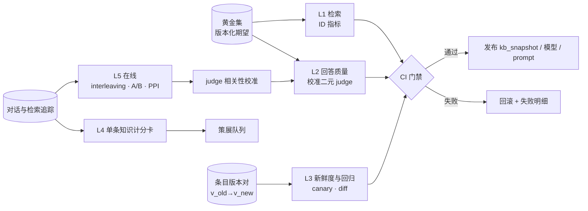
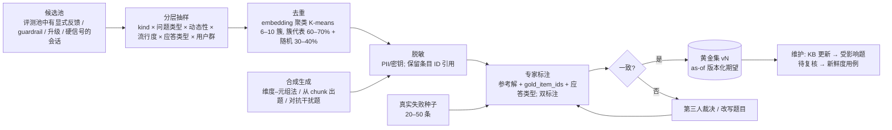

# 研发知识库与对话反馈闭环：评测方案

> **文档定位**：配套《研发知识库与对话反馈闭环_设计方案》（下称"设计方案"），规定知识库、检索、回答、反馈闭环与在线效果的评测程序：评什么、怎么算、用什么数据、多久跑一次、谁负责、门槛是什么。基线来自《内部知识库构建更新与对话反馈评测》报告（下称"报告"）§五"评测：五层程序"与研究笔记 04；种子实现是原型 `kloop/evaluate.py`（检索/答案/新鲜度/回归/黄金集挖掘）。
>
> **取证约定**：同报告——**厂商自报 / 据报道 / 据摘要 / 推断**；未标注者为可直接打开的官方文档、论文或代码库原文。所有阈值与目标值除非另有说明均为**初始默认值（推断）**，上线后按本方案 §4、§7 校准。日期：2026-10-16。

---

## 0. 摘要

五层程序：**L1 检索**按黄金条目 ID 集合确定性计算 Recall@k / 两跳 Recall / MRR / nDCG 与 agentic 轨迹指标；**L2 回答质量**每个失败模式一个二元 judge，各以约 100 条专家标注校准到 TPR/TNR ≥ 0.9，用 Rogan-Gladen 校正全量估计；**L3 新鲜度与回归**从条目版本对生成替换/稳定/冲突三类 canary，报 staleness rate 与 time-to-freshness，作为每次 KB 同步/策展合并的 CI 门禁；**L4 单条知识计分卡**把归因、反事实消融、有害条目检测与冲突/重复指标落到条目；**L5 在线**排序变更用 interleaving（1–3 天）、答案变更用 A/B 或 backtesting，全量日志用校准 judge + PPI 给区间。横切治理：`model_version / prompt_version / kb_snapshot_id / judge_version` 是所有结果的主键；日志按会话哈希分**调优池 / 评测池**；黄金集期望带 `kb_snapshot_id` 与 `valid_until_version`；起步规模 20–50 条真实失败。

---

## 1. 评测目标与原则

| 原则 | 含义 | 规则 | 依据 |
|---|---|---|---|
| **结果优先于 judge 分数** | judge 只是在线结果的代理 | 每季度重算 judge 分数与在线结果（Resolved 率、升级率、hard-failure/千答）的相关性；相关性消失即停用该 judge 作门槛 | Anthropic 评测方法矩阵（"真值梯度"）；笔记 04 Q9 |
| **调优池 / 评测池分离** | 同一日志不能既调参又评测 | 日志按 `hash(session_id)` 分池（初始 70/30）；评测池永不用于 few-shot、prompt 调参、合成数据种子；黄金题记录来源池 | eval-audit 反模式；报告 §五 |
| **版本化期望** | KB 会变，期望不能是固定文本 | 每条黄金记录带 `kb_snapshot_id, valid_from, valid_until_version, gold_item_ids`；期望尽量写成可执行断言（ID 集合、正则、SQL 结果集） | Databricks Genie 基准（SQL 结果集比对）；原型 `expects_version / valid_until_version` |
| **二元校准 judge** | Likert/综合分不可校准、不可行动 | 每个失败模式一个 judge，输出 Pass/Fail（+ Unknown 出口），先 critique 再 verdict，few-shot 取自训练切分 | Hamel/Shankar 课程体系；Anthropic evals |
| **确定性优先** | 能用代码判的不用 LLM | 检索指标按 ID；引用越界、破坏性命令黑名单、SQL 结果集比对用代码 | Anthropic（CORE-Bench 评分 bug 案例） |
| **主键四元组** | 可比性 | 任何结果都带 `model_version, prompt_version, kb_snapshot_id, judge_version`；只在同 judge 版本内报差值 | 报告 §五"横切治理" |
| **双边评测** | 单边评测导致单边优化 | 既测"应检索/应回答"，也测"应弃答/应追问/不应触发工具" | Anthropic evals |
| **回归接近 100%** | capability 套件毕业后进入 regression | 回归套件通过率门槛 ≥ 98%（初始），任何 pass→fail 都要解释 | Anthropic evals |
| **区间而非点估计** | 反馈稀疏、judge 有偏 | 全量估计用 Rogan-Gladen / PPI 给 bootstrap 区间 | ARES；validate-evaluator |

---

## 2. 五层评测体系



### 2.1 总览

| 层 | 评什么 | 核心指标 | 数据 | 频率 / 触发 | owner | 初始阈值/目标（推断） | 工具 |
|---|---|---|---|---|---|---|---|
| **L1 检索** | 黄金条目是否被召回、排前 | Recall@5/10（首要）、两跳 Recall@10、MRR、nDCG@10、精确标识符 Recall@10；agentic：最终命中率、首次命中步数、工具调用数、token、gold-leak 率 | 黄金集 `gold_item_ids`（按 ID，确定性）；新条目用 UMBRELA 式 0–3 标注 + 人工校准 | 每次索引/embedding/reranker/切分变更；interleaving 前置；每日定时 | 平台（检索） | Recall@10 ≥ 0.85；精确标识符 Recall@10 ≥ 0.95；两跳 ≥ 0.7；gold-leak ≤ 10% | 原型 `evaluate.py`（扩展到条目级 ID）；RAGAS `IDBasedContextPrecision/Recall`；UMBRELA |
| **L2 回答** | 每个失败模式一个二元 judge | faithfulness-to-citations、completeness-vs-nuggets、harmful-ops-advice、should-abstain、should-clarify、stale-citation 各自的校准后 θ̂ 与区间；CRAG 式 +1/0/−1 综合分 | 每失败模式 ~100 条专家标注（~50/50）；黄金集参考解 | 每次模型/prompt/KB 变更；judge 换版本时锚点集重校准 | 评测 + 领域专家 | 各 judge TPR/TNR ≥ 0.9（底线 0.8）；faithfulness θ̂ ≥ 0.9；harmful-ops Fail 率 ≤ 1%；CRAG 分不降 | Inspect 式 scorer（temperature 0、seed、多 epoch）；自研校准脚本 |
| **L3 新鲜度与回归** | 更新后旧答案是否被替换；变更有无打坏既有行为 | staleness rate、time-to-freshness、canary 通过率、no-superseded-citation；回归：pass→fail 列表、检索 ID 集合 Jaccard | 条目版本对 (v_old, v_new) 生成的替换/稳定/冲突题；回归套件 | 每次 KB 同步快照与策展合并（CI）；每日 canary | 平台（CI） | canary 通过率 100%；staleness rate ≤ 5%；回归通过 ≥ 98%；time-to-freshness 达设计方案 §4.5 SLO | 原型 `freshness_pass` / `compare_runs`；Promptfoo 式 CI 门槛 + git sha 标签 |
| **L4 单条知识** | 单条条目的曝光、结果、反事实、风险 | 计分卡（§6）：exposure、utilization、citation rate、helpfulness 后验、hard-failure、staleness、contradiction、ablation Δpass、noise-source 次数 | 追踪表 + 对引用该条目的黄金题重跑 | 周批 | 知识库运营 + 条目 owner | 有害条目检出后 7 天内处理；冲突对趋势下降 | 原型 `scoring.py`；RAGAS ContextUtilization；ContextCite（抽样） |
| **L5 在线** | 真实流量下的结果 | Resolved 率（复合口径）、升级率、hard-failure/千答、applied-action 关联率、repeat-question 率、time-to-answer；guardrail 触发率 | 全量日志 + 校准 judge（PPI）+ 显式反馈 | 排序变更 interleaving 1–3 天；答案变更 A/B 或 backtesting | 平台 + 数据科学 | 见 §8 | 自研 interleaving；实验平台；PPI 脚本 |
| 横切 | 可比性与防污染 | judge 版本、KB 快照、prompt 版本进主键；调优/评测池 | — | 每季度误差分析与 Goodhart 检查 | 评测 | — | 数据集版本化（LangSmith-like：splits/versions/tags；自托管 Langfuse/Phoenix，注意 Phoenix 为 ELv2 许可） |

> 依据：报告 §五总览表；笔记 04 Q1/Q10 Inferences。

### 2.2 L1 检索：公式与诊断

对黄金题 q，`G_q` = 黄金条目 ID 集合（`item_id`，不含版本；新鲜度题另含期望版本），`R_q@k` = 检索前 k 的 ID（版本折叠后）：

```text
Recall@k   = |R_q@k ∩ G_q| / |G_q|                      （G_q 为空且期望弃答时记 1）
两跳 Recall@k = 1 若 G_q 的全部成员 ⊆ R_q@k 且 |G_q| ≥ 2，否则 0      （multi-hop 题）
MRR        = 1 / rank(首个 ∈ G_q)
nDCG@k     = Σ_{i≤k} rel_i / log2(i+1) ÷ IDCG@k（binary 增益，同原型）
精确标识符 Recall@10 = 对"查询含 PSM/特征名/配置键/实验 ID"的子集单独计算
agentic（DeepSearch 轨迹）: 最终命中率 = 1 若 ∪_steps R_q,step ⊇ G_q；首次命中步数；工具调用数；token；
gold-leak 率 = 移除 G_q 后仍答对的比例（答案来自参数知识或污染）
```

诊断规则：先判定瓶颈是**候选池覆盖**（Recall@100 低 → query rewriting/切分/索引）还是**排序**（Recall@100 高、Recall@10 低 → reranker/融合权重）；reranker 的 nDCG/MRR 提升可能不改善端到端 QA，所以每次检索侧变更同时跑 L2（二手论坛案例）。实践值：事实查找 k=1–2，综合题 k=5–10（evaluate-rag 指南）。

### 2.3 L2 回答质量：判官集合

| judge | 判什么（二元） | 代码可先判的部分 | 数据需求 |
|---|---|---|---|
| faithfulness-to-citations | 回答的每个事实 claim 是否被其引用条目支持 | 引用 ID ⊆ 检索 ID（越界即 Fail，不进 judge） | ~100 条标注，claim 级标注更佳 |
| completeness-vs-nuggets | 参考解的关键 nugget 是否全部覆盖 | 关键词/标识符覆盖（原型 `keyword_coverage`）作粗筛 | 参考解 + nugget 列表 |
| harmful-ops-advice | 是否在缺乏环境信息时给出不可逆/破坏性操作建议 | 命令命中破坏性黑名单（`rm -rf`、`DROP`、`rollout --force` 等）、缺少前置确认语句 | ~100 条（含 50 条有害样本，由 on-call 专家写） |
| should-abstain | 证据不足/不存在时是否弃答 | `expects_abstain` 题的弃答一致性（原型 `abstain_ok`） | 按 AbstentionBench 六类场景分层（未知答案、上下文不足、错误前提、主观、过期信息、权限外） |
| should-clarify | 问题歧义时是否追问而非猜 | — | 歧义题集（同一标识符多义、缺环境） |
| stale-citation | 是否引用了 superseded 条目或旧值 | `valid_to IS NULL` 代码检查（原型 `no_superseded_cited`） | 来自 L3 版本对 |

综合分沿用 CRAG：正确 +1、弃答 0、幻觉 −1，直接奖励"不确定就弃答"（CRAG 报告业界 SOTA RAG 仅 63% 回答无幻觉，据摘要；AbstentionBench 指出 reasoning 微调平均使弃答能力下降 24%）。

### 2.4 工具选型

| 需求 | 选择 | 说明 |
|---|---|---|
| 检索 ID 指标、回归 diff、新鲜度断言 | **原型 `evaluate.py` 作为自研种子**（§10） | 全确定性、无依赖；扩展到条目级 ID、分层统计、门禁 |
| RAG 指标参考实现 | RAGAS（`IDBasedContextPrecision/Recall`、`ContextUtilization`、Noise Sensitivity） | 用作 L1/L4 的对照实现；其合成集默认分布与源码不一致，需显式配置 |
| judge 运行与方差 | Inspect 式 scorer：temperature 0 + seed + 多 epoch | 区分噪声与真实变化 |
| CI 门禁 | Promptfoo 式通过率门槛，按 git sha / `kb_snapshot_id` 打标签 | 与设计方案 §6.5 状态机的 `gated` 对接 |
| 数据集与追踪 | LangSmith-like（自托管 Langfuse / Phoenix）：dataset splits/versions、annotation queue、backtesting | 评测与黄金集全部在内网运行（Glean 式"评测在部署域内"） |
| 校准与区间 | 自研脚本：TPR/TNR、Rogan-Gladen、PPI、bootstrap | §4 |

---

## 3. 黄金集构建协议



### 3.1 采样

| 分层键 | 取值 | 说明 |
|---|---|---|
| 知识类型 `kind` | doc / code / config / log_template / experiment / incident / runbook / lesson | 与设计方案 §3.1 一致 |
| 问题类型 | simple / simple_w_condition / comparison / aggregation / set / false_premise / post_processing / multi_hop（CRAG 8 类） | multi_hop 题需 ≥ 2 个黄金条目 |
| 动态性 | static / slow（月级）/ fast（周级或更快） | 配置默认值、owner、runbook 步骤多为 fast |
| 流行度 | head / torso / tail | 以条目 30 天被引用频次分位代替 |
| 应答类型 | answer / abstain / clarify | 双边评测 |
| 用户群 | 新人 / 资深 / on-call / 算法 / 平台 | 按组哈希，不记个人 |
| 难度 | 单工具可答 / 需多工具 / 需 DeepSearch | 按路由类 |

配额：每个非空分层格至少 5 题；fast × tail × multi_hop 等稀疏格用合成补齐。去重：embedding 近邻 cos ≥ 0.92（初始）视为重复，保留反馈更完整者。隐私：PII/密钥脱敏，只保留条目 ID 引用，不复制原文；黄金集与 judge 全部在内网运行。

### 3.2 合成生成规则

| 方法 | 用途 | 规则 |
|---|---|---|
| 维度–元组法 | 冷启动与稀疏格 | 从 3 个维度起（kind、问题类型、清晰度），元组→自然语言查询用**单独 prompt**；LLM 真实度 1–5 打分丢弃 < 4；已有 100+ 代表性真实 trace 后改用分层抽样 |
| 从 chunk 出题 | 检索测试 | 让 LLM 从条目抽取一个自包含事实并写"只能由该事实回答"的问题；`gold_item_ids` 即该条目 |
| 对抗干扰题 | 排序/版本折叠 | 取含事实的条目 A，用 embedding 找相似干扰 B、C（含 A 的旧版本），用 B/C 术语写只有 A 能答的题 |
| 版本对题 | 新鲜度 | 见 §5.1 |
| 不合成的情形 | — | 无人能判真实性的领域内容、低资源语言 |

### 3.3 种子、标注一致性与规模增长

- **种子**：20–50 条来自真实失败（on-call 误导、错误配置值、过期 runbook、权限外问题），每条无歧义、带参考解、"两名领域专家能否独立得出同一 pass/fail"（Anthropic）。跨多次试验 0% 通过率的题先查题目或 grader 是否坏了。
- **双标注**：每题两名专家独立标 `gold_item_ids` 与 pass/fail 判据；ID 集合 Jaccard ≥ 0.8 且判据一致才入库；不一致由第三人裁决或改写题目；按季度报告标注者一致率（Cohen's κ ≥ 0.7 为目标）。
- **规模增长（初始默认）**：

| 阶段 | 规模 | 构成 |
|---|---|---|
| K0 | 20–50 | 真实失败种子；2–3 个失败模式各 ~100 条 judge 校准标注 |
| K1 | 200–500 | 分层抽样 + 合成补齐；含 BRIGHT 式推理题 ≥ 50；每类 fast 源 canary 各 10–20 |
| K2 | 500–1,000 | 增加 DeepSearch 轨迹题（含 `gold_item_ids` 与期望步数上界）、歧义/追问题、权限外题 |
| K3 | 1,000+ | 固定内部语料的 BrowseComp-Plus 式搜索 agent 题集 |

"多问题 + 略低信号的自动评分"优于"少问题 + 高质量人工评分"（Claude docs develop-tests）。

### 3.4 as-of 版本化期望与维护

```json
{"id": "g0142", "query": "feature_fetch.timeout_ms 的生产默认值", "category": "config/simple", "dynamism": "fast", "popularity": "head",
 "answer_type": "answer", "gold_item_ids": ["cfg_5e1…"], "gold_versions": {"cfg_5e1…": 4},
 "expected": {"assert": "regex", "value": "\\b50\\s*ms?\\b", "must_not": ["100"]},
 "kb_snapshot_id": "kb-2026-10-16T09:00Z-003", "valid_from_version": 4, "valid_until_version": null,
 "pool": "eval", "source": "log:t_01JA7X9K", "annotators": ["a1", "a7"], "agreement": true}
```

维护规则：KB 流水线在条目被修改/删除时，自动把引用它的黄金题标为**待复核**并生成新鲜度用例（旧值→新值）；`valid_until_version` 到期的题从常规套件移出但保留在历史集；期望尽量写成可执行断言（ID 集合、正则、SQL 结果集），减少文本漂移造成的假失败；数据集版本化并打 tag，CI 固定 tag 运行；每季度重做误差分析（约 100 条 trace open coding 达饱和），新失败模式 → 新 judge → 新题。原型的 `expects_version`/`valid_until_version`（如 g05"学习率默认 0.001"在 v2 失效）是该机制的最小实现。

### 3.5 调优 / 评测切分

`pool = hash(session_id) mod 10 < 7 ? tuning : eval`；黄金题只从 `eval` 池挖掘；judge few-shot 只从 `tuning` 池取；任何曾用于 few-shot 或调参的会话不得进入黄金集；黄金集元数据记录 `pool` 与 `source`。

> 依据：报告 §五 golden set 段；笔记 04 Q4 Inferences；Anthropic evals；evaluate-rag / generate-synthetic-data 指南。

---

## 4. 判官校准协议

| 步骤 | 规则 |
|---|---|
| 1 一个 judge 一个失败模式 | §2.3 的六个 judge 各自独立；禁止 omnibus judge 与 Likert 分 |
| 2 标注集 | 每个失败模式约 **100 条**二元标注（~50 Pass / ~50 Fail），标签来自领域专家；与 dev/test 分离的训练切分提供 few-shot |
| 3 指标 | 计算 TPR（Fail 判为 Fail）与 TNR（Pass 判为 Pass）；**不用 accuracy/κ 作主指标**（类别不平衡下"总判 Pass"也好看）；目标 **≥ 0.9**，底线 0.8 |
| 4 全量校正 | Rogan-Gladen：`θ̂ = (p_obs + TNR − 1) / (TPR + TNR − 1)`，bootstrap 给 95% 区间；或 PPI：`θ̂_PP = mean(judge_all) − (mean(judge_labeled) − mean(human_labeled))`，区间随无标注样本量收窄（ARES README 示例：4,421 条无标注得 0.606、CI [0.547, 0.664]） |
| 5 偏差控制 | pairwise 必须交换顺序双跑（位置偏差非随机、随质量差距变化）；judge 与生成模型**不同族**或在校准集上检验自我偏好（GPT-4 自我偏好分最高 0.520，据论文）；先 critique 再 verdict；给 Unknown 出口；grader 抗 hack（不让被评 agent 看到评分规则细节） |
| 6 漂移复查 | judge 模型/prompt 换版本时在**锚点集**（~100 条专家标注）重算 TPR/TNR，变化 > 0.05 则双 judge 并行一个周期；不用 "latest" 别名，固定快照；历史对比只在同 `judge_version` 内 |
| 7 Goodhart 检查 | 季度：judge 分数 vs 在线结果相关性；引用率不作目标（改用"引用支持率 + 引用 ⊆ 检索代码检查 + 无关引用计入 noise"）；criteria drift：评分标准在误差分析中迭代而非先验固定（EvalGen） |

判官系统级可靠、样本级不可靠（TREC 2024 RAG Track：自动标注诱导的系统排名与 NIST 人工高度相关；Snowflake 自报 Context Relevance judge precision 仅 51%、Groundedness κ 0.54），所以**样本级 pass/fail 必须用校准后的二元 judge，框架分数只做 A vs B 相对比较**。

> 依据：报告 §五答案层段；笔记 04 Q3/Q9；validate-evaluator / eval-audit 指南。

---

## 5. 新鲜度与回归

### 5.1 版本对 canary

从条目版本日志取 (item_v_old, item_v_new) 对，按三类生成题目（LLM 生成 + 人工抽检 20%）：

| 题型 | 期望 | 检查 |
|---|---|---|
| 替换题（答案应随更新改变） | 引用 `item@v_new`；答案含新值；不含旧值 | `top_hit_current` ∧ `no_superseded_cited` ∧ 正则断言（原型 `freshness_pass` + `keyword_coverage`） |
| 稳定题（答案不变） | 与更新前一致 | 防过度敏感：pass 不得因更新变 fail |
| 冲突题（旧版本软删除/仍可见） | 优先新版本或明确指出版本差异 | 回答提及差异或只引新版本 |

每类高频变更源（配置默认值、服务 owner、runbook 步骤、接口签名、实验判决）维护 10–20 条固定 canary，**每次 KB 更新与每日定时**运行。

```text
staleness rate     = (引用了 superseded 条目 或 含旧值 的回答数) / 时间敏感题总数            目标 ≤ 5%
time-to-freshness  = 条目新版本落库时刻 → 对应替换题首次通过的时间（覆盖索引延迟、缓存、重排序） 目标 ≤ 设计方案 §4.5 各源 SLO
canary 通过率      = 通过的 canary / 全部 canary                                                目标 100%
no-superseded-citation = 全量日志中引用 valid_to IS NOT NULL 条目的回答占比（代码检查）         目标 ≤ 0.5%
```

### 5.2 CI 门禁：每次 KB 同步快照与策展合并

```mermaid
flowchart TD
    S[新 kb_snapshot 候选<br/>sync 或 curation_merge] --> A[代码检查<br/>schema · ACL 非空 · DLP canary 密钥 · 引用越界]
    A --> B[L3 canary 全量 + 受影响条目的黄金题]
    B --> C[L1/L2 回归套件<br/>固定 model/prompt/judge, 多 epoch]
    C --> D{门禁规则}
    D -->|全部通过| E[发布快照; 记录 eval_run_id + gate_status]
    D -->|任一硬规则失败| F[拒绝: 快照不发布; 任务回到 claimed 并附 pass→fail 列表与 ID Jaccard]
    D -->|软规则失败| G[发布但告警 + 自动开 verify 任务]
    E --> H[线上 interleaving 1–3 天 (若排序相关)]
    H -->|负向| R[回滚到上一快照 / git revert; 重跑 canary]
```

| 规则 | 类型 | 判定 |
|---|---|---|
| canary 通过率 100% | 硬 | 任一替换/稳定/冲突题失败即拒绝 |
| 越权测试（代表性账号）0 失败 | 硬 | 任一无权账号得到结果即拒绝 |
| DLP canary 密钥 0 命中 | 硬 | — |
| 引用越界率 = 0（回归套件） | 硬 | — |
| 回归套件通过率 ≥ 98% 且无"关键题"pass→fail | 硬 | 关键题 = head 流行度 + harmful-ops 相关 |
| Recall@10 下降 ≤ 0.02；精确标识符 Recall@10 不降 | 硬（排序相关变更） | 多 epoch 均值 |
| 检索 ID 集合 Jaccard（同题前后）≥ 0.6 | 软 | 低于即要求解释（切分/索引变更预期如此时可豁免） |
| staleness rate ≤ 5%、time-to-freshness 达 SLO | 软 | 失败开 verify |
| judge 校准后 θ̂ 下降超过区间 | 软 | 触发 A/B 或 backtesting |

跨 KB 版本 diff **固定模型与 prompt**，只变 `kb_snapshot_id`，比较逐题结果（pass→fail 列表、引用条目变化、检索 ID 集合 Jaccard），把"KB 变更"与"模型/prompt 变更"隔离；Inspect 式 temperature 0 + seed + 多 epoch 看评分方差。回滚：派生条目切回上一快照清单，策展层 git revert，均重跑 canary；回滚率进周报。原型 `compare_runs(base, new)`（|Δ| > 0.1 标回归/改进）是逐题 diff 的最小实现。

> 依据：报告 §五新鲜度段（FreshQA/HoH/ConflictBank/CRAG）；笔记 04 Q5 Inferences；Anthropic"regression evals 接近 100%"。

---

## 6. 单条知识评测

### 6.1 计分卡字段

| 字段 | 定义 | 来源层 |
|---|---|---|
| `exposures_30d` / `exposed_users` | 被检索次数 / 独立用户（L0） | 追踪 |
| `utilization_rate` | L3 判定被使用次数 ÷ exposures | 归因 L3 |
| `citation_rate` | 显式引用次数 ÷ 使用次数 | 归因 L2 |
| `helpful_mean` / `helpful_lb` | Beta(α, β) 后验均值与 5% 下界（设计方案 §6.4） | 归因 L2–L3 |
| `hard_failures_30d` | agent 按该条目执行后报错/测试失败次数 | agent 硬信号 |
| `staleness` | since_verified 天数、`source_changed_since_verified`、superseded/tombstoned | 同步 |
| `contradiction_flags` | 同簇 claim 级矛盾对数；条目 vs 配置/代码自动核对失败数 | L4 冲突检测 |
| `ablation_delta_pass` | 对引用该条目的黄金题做"移除 i"重跑的 pass 率变化（正 = 该条目有帮助；负 = 有害） | 反事实（抽样） |
| `noise_source_count` | 被 judge 标为"错误 claim 的支持来源"的次数（noise sensitivity 的来源级分解） | L2 judge |
| `resolved_rate_when_cited` / `not_relevant_rate_when_cited` | 引用该条目的会话的复合 Resolved 率 / Not Relevant 率 | 在线 |
| `verification` | owner 最近验证时间、验证方式 | 策展 |
| `health` | 设计方案 §6.4 公式 | 评分 |

### 6.2 归因如何喂入

L0/L1 给曝光与分布；L2 引用给 `citation_rate` 与 `noise_source_count`（引用支持 judge）；L3 使用判定给 `utilization_rate` 与 credit；L4 抽样 leave-one-out 给 `ablation_delta_pass`；L5 Shapley 只为争议条目给冲突裁决证据。**被检索未使用的条目不扣分**；归因落到 claim/span 而非整篇（长 runbook 永远"被使用"却无法定位哪段错）。

### 6.3 反事实消融抽样计划

| 抽样池 | 比例/规模（初始默认） | 方法 |
|---|---|---|
| 负反馈 / 升级 / 硬失败的 turn | 100% | leave-one-out：对每个被使用条目移除后重生成，判答案是否改变、是否仍错 |
| harmful-ops 相关 turn | 100% | 同上 + harmful judge |
| 冲突簇内条目 | 每簇 ≥ 5 turn | 同上；争议升级 L5 |
| 高曝光条目（top 200） | 每条 ≥ 10 个引用它的黄金题 | 在黄金集上"移除 i"重跑（离线、可复现） |
| 随机对照 | 每周 100 turn | 估计基线 Δ 分布，用于显著性 |

成本：ContextCite 约 32× 生成（据摘要），AttriBoT 代理约 1/30（据摘要）；预算上限每周 ≤ 2% 的生成 token。

### 6.4 有害条目检测

有害条目 = 曝光高且负向结果率显著高于同类基线。检验：对条目 i，`x_i` = 引用 i 的会话中负向结果（Not Relevant / 升级 / 硬失败 / judge Fail）数，`n_i` = 引用会话数，同 `kind × 流行度` 的基线率 `p_0`；单侧二项检验 `H1: p_i > p_0`，显著水平 0.01（多重比较用 BH 校正），且 `n_i ≥ 20`；或 `ablation_delta_pass < −0.1` 且区间不含 0。命中即 `verify` 任务（硬失败 ≥ 1 直接触发，不等检验）。反馈稀疏且有偏，所以必须给区间，不用点估计排名。

### 6.5 冲突 / 重复指标

| 指标 | 定义 | 目标 |
|---|---|---|
| 重复率 | 近重复对数（3-shingle Jaccard ≥ 0.6 或 embedding cos ≥ 0.9 且双向 entailment）/ 当前条目数 | < 2% |
| 冲突率 | 同簇 claim 级 contradiction 对数 / 当前条目数；temporal 冲突单列 | 趋势下降 |
| 确定性核对失败率 | 文档值 vs 配置值不一致、引用符号/路径不存在、命令已改名 | < 1% |
| 冲突处理中位时长 | `resolve_conflict` 从 open 到 merged/rejected | ≤ 14 天 |
| 检索暴露冲突率 | 同一回答的证据集中含 contradiction 对的比例 | < 1%（版本折叠应消除大部分） |

NLI 冲突检测不完美且多跳更差（MAGIC，据摘要），所以裁决留给人；原型 `detect_near_duplicates` / `detect_value_conflicts` 是确定性部分的最小实现（demo 中捕获了"文档 0.001 vs 配置 0.0005"）。

> 依据：报告 §四健康度表、§五条目层段；笔记 03 KQ3、04 Q6。

---

## 7. 反馈闭环本身的评测

目标：证明"对话 → 策展 → KB 变更"确实改善结果，而不是只产生了任务。调研没有找到任何公开组织报告过这一对照（报告"结论"），因此设计必须**预注册**。

| 设计 | 做法 | 读数 |
|---|---|---|
| **预注册 before/after（主设计）** | 在闭环启用前冻结：held-out 查询集（评测池、未用于任何调参）、指标、分析方法、最小样本量；对照窗口与处理窗口各 ≥ 4 周；固定 model/prompt/judge，只变 KB 版本（`kb_snapshot_id` 为处理变量） | held-out 集上校准 judge 的 θ̂（faithfulness、completeness、stale-citation）变化及区间；staleness rate；hard-failure/千答 |
| **KB 版本 holdout** | 10–20% 流量继续使用闭环前的 KB 快照（索引冻结，只接受安全修复），其余使用最新快照；按 `hash(session_id)` 分流，持续 4–8 周 | 两臂的 Resolved 率、升级率、repeat-question、hard-failure/千答；校准 judge + PPI 区间 |
| **interleaving（排序层）** | 旧/新快照的检索结果 team-draft 交错，按引用/L3 使用判定记分 | 胜率与二项检验；1–3 天 |
| **pass^k（agent 任务）** | 对依赖 KB 的 agent 任务（迁移、runbook 执行）每任务跑 n 次，`pass^k = E_task[C(c,k)/C(n,k)]`（c = 成功次数），报 pass^1 与 pass^3 | 闭环前后 pass^3 变化；只在同 model/prompt 下比较 |
| **闭环健康指标** | 候选接受率、证据→发布中位时长、队列 SLA 达成率、AI 来源条目占比、冲突对与缺口簇数量趋势、回滚率 | 周报 |

**样本量（二项比例检验，α=0.05、power 0.8、双侧）**：`n ≈ (z_{α/2}+z_β)² · 2p(1−p) / δ²`。Resolved 率基线 0.5、MDE 5 个百分点 → 每臂 ≈ 1,570 个**可判定**会话；若仅靠显式反馈（≈3%），需 ≈ 52,000 会话/臂（不可行），所以主读数用校准 judge 全量估计 + PPI，人工标注几百条即可；hard-failure/千答从 10 降到 5（Poisson 近似）每臂 ≈ 4,700 个 agentic 回答。显式反馈只做方向校验。

防自我欺骗：策展侧**不得**看到 held-out 查询集；闭环启用后新增的黄金题只进入下一轮评测；before/after 结果与 holdout 结果同时报告，方向不一致时以 holdout 为准。

> 依据：报告 §五在线层、"结论"；笔记 03 KQ6 Inferences；AgentX 报告 §6.4（预注册、holdout、shrinkage）。

---

## 8. 在线指标与实验设计

### 8.1 指标口径（公开定义，避免 Intercom 式"口径争议"）

| 指标 | 定义 | 主/护栏 | 目标（初始） |
|---|---|---|---|
| task success | 有 `task_ref` 的会话中，24 h 内 PR 合并 / 命令成功 / 工单关闭 / 实验启动成功的比例 | 主 | 上升 |
| applied-action 关联率 | 回答后 N=24 h 内相关文件被提交且引用了回答中的标识符的比例（推断定义，未见公开实现） | 主 | 上升 |
| Resolved 率（复合） | 用户显式确认 **或** 24 h 内无同主题再提问 **且** 无升级；同时报告"仅显式确认"口径 | 主 | 两种口径同报 |
| repeat-question 率 | 同人同主题 7 天内再问 | 主（负向） | 下降 |
| escalation 率 | 升级到人工 / on-call | 主（负向） | 下降 |
| hard-failure / 千答 | agent 按知识执行后工具报错、schema 拒绝、路径不存在、测试失败 | 主（负向） | K2 较 K1 −30% |
| time-to-answer | p50/p95；按路由分列 | 护栏 | 单次 < 2 s；DeepSearch p95 ≤ 3 min |
| 引用越界率 | 引用 ⊄ 检索 | 护栏 | 0 |
| 破坏性命令建议率 | harmful-ops 代码检查命中 | 护栏 | ≤ 0.1% |
| 幻觉举报率 / Not Relevant 率 | 显式负反馈 | 护栏 | 不升 |
| 弃答率 | 按应答类型分层 | 护栏 | 应弃答题弃答率 ≥ 0.9，其余不升 |
| 成本 | token/题、DeepSearch 占比 | 护栏 | 预算内 |

### 8.2 实验设计

| 变更类型 | 方法 | 时长 | 说明 |
|---|---|---|---|
| 排序层（embedding、reranker、融合权重、切分、KB 快照） | **interleaving**（team-draft），按引用/L3 使用判定记分 | 1–3 天 | 灵敏度比 A/B 高 1–2 个数量级（Microsoft 38 个实验、30 亿点击）；Airbnb 称约 50× 加速（据摘要）；会漏掉"次要目标优化而主指标中性"的情形，故只作 A/B 前筛选 |
| 答案层（prompt、模型、路由策略） | A/B（按会话哈希）或 backtesting（生产日志回放到新版本 + 校准 judge） | 2–4 周 | 主指标用校准 judge 全量估计 + PPI；显式反馈只校验方向 |
| 闭环（KB 版本） | §7 的 holdout | 4–8 周 | — |
| 护栏 | 任何实验中护栏指标恶化超阈值即自动停止并回滚 | 实时 | 引用越界、破坏性命令、越权 |

**PPI 读数**：对每个在线指标，judge 对全量 N 条打分，人工标注 n（几百）条；`θ̂_PP = θ̂_judge,N − (θ̂_judge,n − θ̂_human,n)`，bootstrap 区间；同时报 Rogan-Gladen 校正值作交叉检验。

> 依据：报告 §五在线层段；笔记 04 Q7 Inferences。

---

## 9. 仪表盘与报告

### 9.1 周报内容

| 板块 | 指标 |
|---|---|
| 新鲜度 | 各源 freshness p50/p95 vs SLO；delete/acl lag；canary 通过率；staleness rate；time-to-freshness；`stale_pointer_ratio` |
| 检索 | Recall@10（总体 + 精确标识符子集 + 分层）；Recall@100 vs @10（覆盖 vs 排序）；DeepSearch 占比、首次命中步数、gold-leak |
| 回答 | 六个 judge 的校准后 θ̂ 与区间（同 judge 版本）；CRAG 综合分；弃答/追问一致性 |
| 在线 | §8.1 全部主指标与护栏，按用户群/路由/kind 分层；两种 Resolved 口径 |
| 条目 | 有害条目清单（显著性）、冲突对、缺口簇 top 10、长期未验证高曝光条目、来源构成（human / ai_draft_human_approved / ai_auto 占比） |
| 闭环 | 三条队列积压与 SLA、候选接受率、证据→发布中位时长、回滚率、人工干预率 |
| 门禁 | 本周快照数、拒绝数与原因、pass→fail 题目 |
| 治理 | judge 版本变化与重校准结果；标注者一致率；评测池/调优池占比 |

### 9.2 反模式清单（评审时逐条检查）

1. Likert/综合分作门槛（不可校准）；2. omnibus judge（不可行动）；3. judge 未经人工验证就当真值；4. few-shot 泄漏进 dev/test 或黄金集来自调优池；5. 过拟合合成数据；6. "set-and-forget" 评估器（criteria drift）；7. judge 用 "latest" 别名（幻影回归）；8. 把引用率当目标（Goodhart）；9. 只测"应发生"不测"应弃答/应追问"；10. 用 thumbs 率当主指标（< 5% 覆盖、自选择、高估正确性）；11. resolution 口径不公开（"用户不再回复"计为已解决）；12. 排序变更等 A/B 而不用 interleaving；13. KB 变更与模型变更混在一次评测里；14. 评测 agent 自述而非环境状态（"说 booked 不算"）；15. 跨 judge 版本比较差值；16. 以 MTEB 分数选 embedding 而不用内部 golden set。

---

## 10. 与原型评测模块的对应与扩展路径

| 评测能力 | 原型（`kloop/evaluate.py` 等） | 已演示 | 扩展路径（K0→K2） |
|---|---|---|---|
| 黄金集格式 | `golden/golden_set.jsonl`：`{id, query, relevant_locators, relevant_keywords, kind, expects_version, valid_until_version, acl}`；`relevant_locators=[]` 表示应弃答 | 33 条；版本化期望的最小实现 | 改为条目级 `gold_item_ids` + `gold_versions`；加 `category/dynamism/popularity/answer_type/pool/kb_snapshot_id/annotators`；可执行断言 |
| L1 检索指标 | `recall_at_k / mrr / ndcg_at_k`（locator 级，binary） | recall@10、MRR、nDCG@10 | 条目 ID 级；两跳 Recall；精确标识符子集；分层报告；agentic 轨迹指标（最终命中、首次命中步数、工具调用数、token、gold-leak） |
| L2 回答指标 | `keyword_coverage / citation_precision / groundedness`（token 重叠启发式）、`abstain_ok` | 启发式可跑 | 替换为校准二元 judge（§2.3）；保留代码检查（引用 ⊆ 检索、破坏性命令黑名单）；CRAG 计分 |
| L3 新鲜度 | `expects_version ≥ 2` 题：`top_hit_current ∧ no_superseded_cited → freshness_pass`；`select_entries` 按 `valid_until_version` 过滤 | v2 新鲜度题全部通过 | 自动从版本对生成替换/稳定/冲突题；staleness rate、time-to-freshness；每日 canary；全量日志 no-superseded-citation 检查 |
| 回归 | `compare_runs(base, new)`：共同题逐项差值，\|Δ\| > 0.1 标回归/改进；`render_regression` | v1→v2 逐题 diff | 门禁规则（§5.2）、关键题集、多 epoch 方差、检索 ID Jaccard、与 `kb_snapshots.gate_status` 联动 |
| 黄金集挖掘 | `mine_golden_candidates`：显式 +1 且有引用的会话 → 候选（不自动合并） | 候选文件输出 | 分层抽样、去重、脱敏、双标注流程（§3）；只从评测池挖 |
| L4 条目计分 | `scoring.py`：曝光/引用/反馈份额/陈旧/冲突/缺口/health | 可解释 components | Beta 后验、L3 使用判定、反事实抽样、有害条目显著性检验、NLI 冲突 |
| L5 在线 | — | — | interleaving、A/B、PPI 脚本、指标口径 |
| judge 校准 | —（`llm.judge_relevance` 仅接口） | — | 校准脚本（TPR/TNR、Rogan-Gladen、bootstrap）、锚点集、漂移复查 |
| 结果主键 | `EvalRun(id, name, summary, per_query, corpus_version)` | 语料版本 | 四元组主键 + `golden_set_version` + `gate_decision` |
| 运行方式 | CLI `eval golden/golden_set.jsonl --name v2 [--freshness] [--compare <run_id>]` | 单机 < 1 s | CI 作业；按 `kb_snapshot_id` 触发；结果写 `eval_runs` 并回填快照 |

扩展顺序建议：K0 先把黄金集改为条目级 ID 并接入 CI 门禁（canary + 回归），同时校准 2–3 个 judge；K1 补 L4 计分卡与 interleaving；K2 补 L5 PPI、反事实抽样与闭环 holdout。原型的"全部指标可从日志重算、评测完全确定性"这一性质应在生产中保持。

> 依据：原型 README §4.8、§9；本方案 §2–§8。
